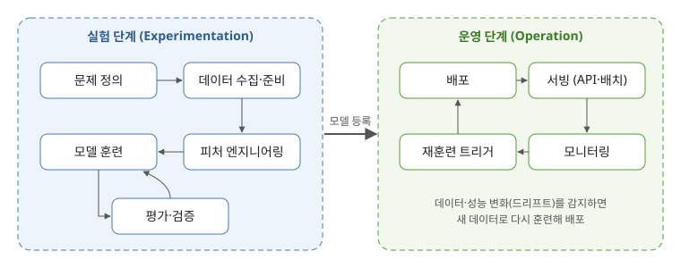
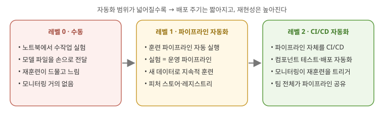
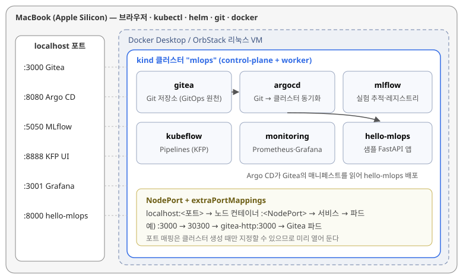

# [MLOps 스터디 1주차] ML 플랫폼의 큰 그림과 맥북 kind로 만든 MLOps 실습 환경

## TL;DR

- **1장**: MLOps는 "모델 하나 잘 만들기"가 아니라 **실험 → 배포 → 운영 → 재훈련**이 반복되는 수명주기를 자동화하는 일이다.
- **2장**: 수명주기의 각 단계(데이터, 훈련, 배포, 모니터링)에 맞는 도구가 있고, 조직은 **수동(레벨 0) → 파이프라인 자동화(레벨 1) → CI/CD 자동화(레벨 2)** 순서로 성숙해 간다.
- **3장**: 그 모든 것의 기반은 **컨테이너 + 쿠버네티스 + GitOps + 모니터링**이다.
- **실습**: 교재는 클라우드 쿠버네티스를 쓰지만, 나는 **맥북 kind 클러스터 하나에 Gitea · Argo CD · MLflow · Kubeflow Pipelines · Prometheus/Grafana**를 올리고 샘플 앱을 GitOps로 배포했다.

---

## 1장. MLOps와 ML 엔지니어링 시작하기

### 핵심 정리

- **ML 시스템에서 모델 코드는 일부일 뿐이다.** 데이터 수집, 피처 처리, 서빙, 모니터링, 재훈련 같은 주변 시스템이 훨씬 크다.
- **ML 수명주기는 두 단계로 나뉜다.**
  - *실험 단계*: 문제를 정의하고, 데이터를 모으고, 피처를 만들고, 여러 모델을 훈련·평가한다.
  - *운영 단계*: 고른 모델을 배포해 서빙하고, 성능을 감시하다가 데이터가 변하면 다시 훈련한다.
- **MLOps**는 DevOps의 자동화·협업 원칙을 이 수명주기 전체에 적용하는 것이다.
- **ML 플랫폼**은 데이터 과학자가 인프라를 몰라도 실험부터 배포까지 셀프서비스로 할 수 있게 해 주는 **내부 개발자 플랫폼**이다. 이 책은 플랫폼을 직접 만들어 보는 관점으로 진행된다.



*그림 1. ML 수명주기 — 실험 루프와 운영 루프가 모델 등록과 재훈련으로 이어진다 (직접 작성)*

### 플랫폼을 이루는 구성 요소

| 구성 요소 | 하는 일 | 이 스터디에서 쓰는 도구 |
| --- | --- | --- |
| 실험 추적 | 하이퍼파라미터·지표·모델 파일 기록, 비교 | MLflow |
| 모델 레지스트리 | 쓸 모델을 버전으로 관리, 승격 | MLflow |
| 피처 스토어 | 훈련·서빙에 같은 피처 제공 | Feast (2주차 예정) |
| 파이프라인 오케스트레이션 | 데이터 → 훈련 → 평가 → 등록 자동 실행 | Kubeflow Pipelines |
| 모델 서빙 | 모델을 API·배치로 제공 | BentoML (예정) |
| 모니터링 | 서비스 지표, 데이터 드리프트 감시 | Prometheus·Grafana, Evidently (예정) |
| 기반 인프라 | 컨테이너 실행, 배포 자동화 | 쿠버네티스, Argo CD, Git |

> 💡 **느낀 점**: 도구 이름보다 "각 도구가 수명주기의 어느 칸을 채우는가"로 보는 게 이해하기 쉬웠다. 도구는 바뀌어도 칸은 그대로다.

---

## 2장. ML 수명주기와 MLOps 성숙도

### 단계별로 무엇을 신경 써야 하나

| 단계 | 핵심 질문 | 실무 포인트 |
| --- | --- | --- |
| 문제 정의 | ML이 정말 필요한가? | 규칙 기반(휴리스틱)으로 충분한지 먼저 확인 |
| 데이터 준비 | 데이터가 믿을 만한가? | 수집·정제·검증, 데이터 버전 관리 |
| 피처 엔지니어링 | 훈련과 서빙이 같은 피처를 쓰는가? | 훈련-서빙 편향(skew) 방지 → 피처 스토어 |
| 훈련·평가 | 어떤 설정이 가장 좋았나? | 실험 추적, 재현 가능한 실행 |
| 배포·서빙 | 배치인가 실시간인가? | 컨테이너화, API 서버, 롤백 가능성 |
| 모니터링 | 성능이 떨어지고 있나? | 서비스 지표 + 데이터/개념 드리프트 |

### DevOps와 MLOps는 무엇이 다른가

| 구분 | DevOps | MLOps |
| --- | --- | --- |
| 버전 관리 대상 | 코드 | 코드 + **데이터 + 모델** |
| 테스트 | 기능이 맞는가 | + 모델 성능이 기준 이상인가 |
| 배포 후 | 코드가 같으면 동작도 같다 | 코드가 같아도 **데이터가 바뀌면 성능이 떨어진다** |
| 자동화 대상 | 빌드·배포 | + 재훈련(지속적 훈련, CT) |
| 참여자 | 개발·운영 | + 데이터 과학자·데이터 엔지니어 |

### MLOps 성숙도



*그림 2. MLOps 성숙도 레벨 0 → 2 (직접 작성)*

- **레벨 0**은 대부분의 팀이 시작하는 곳이다. 문제는 "느리다"보다 **재현이 안 된다**는 점이다.
- **레벨 1**의 핵심은 **실험과 운영이 같은 파이프라인 코드를 쓰는 것**(실험-운영 대칭성)이다. 노트북 코드를 운영용으로 다시 짜지 않는다.
- **레벨 2**는 파이프라인 자체도 코드처럼 테스트·배포한다.

> 💡 **느낀 점**: 우리 팀은 레벨 0과 1 사이쯤. 이번 실습 환경(Kubeflow Pipelines + MLflow)이 레벨 1로 가는 최소 구성이라고 보면 된다.

---

## 3장. 플랫폼의 기반: 컨테이너, 쿠버네티스, GitOps, 모니터링

### 핵심 정리

- **컨테이너(도커)**: 코드 + 라이브러리 + 런타임을 하나로 묶어 어디서나 같은 방식으로 실행한다. ML에서는 "내 노트북에선 되는데" 문제를 없애 준다.
- **쿠버네티스**: 컨테이너를 여러 노드에 배치하고, 죽으면 다시 띄우고, 부하에 따라 늘리고 줄인다.
  - 파드(실행 단위) → 레플리카셋(개수 유지) → 디플로이먼트(롤링 업데이트) → 서비스(고정 접속 주소: ClusterIP / NodePort / LoadBalancer)
  - 설정은 컨피그맵, 민감 정보는 시크릿으로 분리
- **헬름(Helm)**: 여러 매니페스트를 차트로 묶어 값만 바꿔 설치한다.
- **CI/CD + GitOps**
  - CI: 코드 푸시 → 테스트 → 이미지 빌드·푸시
  - CD(GitOps): **Git에 있는 매니페스트가 정답**이고, Argo CD가 클러스터를 그 상태로 계속 맞춘다.
- **모니터링**: 앱이 `/metrics`로 지표를 노출하면 Prometheus가 수집하고 Grafana가 시각화한다.

교재의 3장 실습은 클라우드 쿠버네티스 + GitLab CI + Docker Hub로 진행한다. 나는 **비용 없이 맥북 한 대로** 같은 흐름을 재현해 보기로 했다.

---

## 실습: 맥북 kind로 MLOps 스택 올리기

### 실습 환경

| 항목 | 내용 |
| --- | --- |
| 하드웨어 | MacBook Pro (Apple Silicon), 메모리 32GB |
| 컨테이너 런타임 | Docker Desktop — VM 메모리 **12GB**, CPU 8코어 할당 (OrbStack도 동일하게 동작) |
| 도구 | `kind` v0.29.0, `kubectl` v1.33, `helm` v3.18, `git`, `python 3.11` |
| 설치 대상 | Gitea, Argo CD, MLflow, Kubeflow Pipelines(standalone), Prometheus/Grafana, 샘플 앱 |



*그림 3. 실습 아키텍처 — 모든 서비스를 NodePort로 열고 kind의 포트 매핑으로 localhost에 연결 (직접 작성)*

> ⚠️ **맥 + kind 네트워크 주의**: 맥에서는 도커가 리눅스 VM 안에서 돌기 때문에 kind 노드 IP(`172.18.x.x`)로 바로 접속할 수 없다(Docker Desktop 기준). 그래서 **클러스터를 만들 때 포트 매핑을 미리 열어 두고** `localhost:<포트>`로 접속했다. 포트 매핑은 나중에 추가할 수 없으니 처음에 넉넉히 연다.
>
> 원래 인그레스로 묶으려 했지만, ingress-nginx 프로젝트가 유지보수를 종료하는 중이라 이번에는 단순하게 NodePort로 갔다. 다음 주차에 Gateway API로 바꿔 볼 예정.

### 포트 계획

| 서비스 | 맥(localhost) | NodePort | 네임스페이스 |
| --- | --- | --- | --- |
| Gitea | 3000 | 30300 | `gitea` |
| Argo CD | 8080 | 30080 | `argocd` |
| MLflow | 5050 | 30500 | `mlflow` |
| Kubeflow Pipelines UI | 8888 | 30888 | `kubeflow` |
| Grafana | 3001 | 30301 | `monitoring` |
| 샘플 앱 hello-mlops | 8000 | 30800 | `hello-mlops` |

> MLflow를 5000 대신 5050으로 연 이유: 맥은 AirPlay 수신 기능이 5000번 포트를 쓴다. 처음에 5000으로 매핑했다가 `bind: address already in use`로 클러스터 생성이 실패해서 바꿨다.

### Step 0. 사전 점검

```bash
brew install kind kubectl helm
```

```text
$ docker version --format 'Server {{.Server.Version}} ({{.Server.Arch}})'
Server 28.3.2 (arm64)

$ docker info --format '{{.NCPU}} CPUs / {{.MemTotal}} bytes'
8 CPUs / 12541497344 bytes

$ kind version
kind v0.29.0 go1.24.2 darwin/arm64

$ kubectl version --client
Client Version: v1.33.2
Kustomize Version: v5.6.0

$ helm version --short
v3.18.4+gd80839c
```

VM 메모리가 약 11.7GiB로 잡혀 있는 것을 확인하고 시작했다. 처음에는 기본값(8GB)이었는데, Kubeflow Pipelines까지 올리자 파드들이 `Pending`에 걸려서 12GB로 늘렸다.

맥에서 쓸 포트가 비어 있는지도 미리 확인했다.

```text
$ for p in 3000 3001 5050 8000 8080 8888; do lsof -nP -iTCP:$p -sTCP:LISTEN >/dev/null && echo "$p 사용 중" || echo "$p free"; done
3000 free
3001 free
5050 free
8000 free
8080 free
8888 free
```

### Step 1. kind 클러스터 만들기

```yaml
# kind-mlops.yaml
kind: Cluster
apiVersion: kind.x-k8s.io/v1alpha4
name: mlops
nodes:
  - role: control-plane
    extraPortMappings:
      - { containerPort: 30300, hostPort: 3000 }   # Gitea
      - { containerPort: 30080, hostPort: 8080 }   # Argo CD
      - { containerPort: 30500, hostPort: 5050 }   # MLflow
      - { containerPort: 30888, hostPort: 8888 }   # KFP UI
      - { containerPort: 30301, hostPort: 3001 }   # Grafana
      - { containerPort: 30800, hostPort: 8000 }   # hello-mlops
  - role: worker
```

```text
$ kind create cluster --config kind-mlops.yaml
Creating cluster "mlops" ...
 ✓ Ensuring node image (kindest/node:v1.33.1) 🖼
 ✓ Preparing nodes 📦 📦
 ✓ Writing configuration 📜
 ✓ Starting control-plane 🕹️
 ✓ Installing CNI 🔌
 ✓ Installing StorageClass 💾
 ✓ Joining worker nodes 🚜
Set kubectl context to "kind-mlops"
You can now use your cluster with:

kubectl cluster-info --context kind-mlops

Have a nice day! 👋
```

**설치 후 확인**

```text
$ kubectl get nodes -o wide
NAME                  STATUS   ROLES           AGE   VERSION   INTERNAL-IP   EXTERNAL-IP   OS-IMAGE                         KERNEL-VERSION     CONTAINER-RUNTIME
mlops-control-plane   Ready    control-plane   71s   v1.33.1   172.18.0.3    <none>        Debian GNU/Linux 12 (bookworm)   6.10.14-linuxkit   containerd://2.1.1
mlops-worker          Ready    <none>          55s   v1.33.1   172.18.0.2    <none>        Debian GNU/Linux 12 (bookworm)   6.10.14-linuxkit   containerd://2.1.1

$ docker ps --format 'table {{.Names}}\t{{.Ports}}'
NAMES                 PORTS
mlops-worker
mlops-control-plane   0.0.0.0:3000->30300/tcp, 0.0.0.0:3001->30301/tcp, 0.0.0.0:5050->30500/tcp, 0.0.0.0:8000->30800/tcp, 0.0.0.0:8080->30080/tcp, 0.0.0.0:8888->30888/tcp, 127.0.0.1:52817->6443/tcp

$ kubectl get pods -A
NAMESPACE            NAME                                          READY   STATUS    RESTARTS   AGE
kube-system          coredns-674b8bbfcf-8xk2p                      1/1     Running   0          78s
kube-system          coredns-674b8bbfcf-v9m4q                      1/1     Running   0          78s
kube-system          etcd-mlops-control-plane                      1/1     Running   0          84s
kube-system          kindnet-6sz7d                                 1/1     Running   0          78s
kube-system          kindnet-qp2hn                                 1/1     Running   0          63s
kube-system          kube-apiserver-mlops-control-plane            1/1     Running   0          84s
kube-system          kube-controller-manager-mlops-control-plane   1/1     Running   0          84s
kube-system          kube-proxy-4jw8t                              1/1     Running   0          63s
kube-system          kube-proxy-n7rbc                              1/1     Running   0          78s
kube-system          kube-scheduler-mlops-control-plane            1/1     Running   0          84s
local-path-storage   local-path-provisioner-7dc846544d-hk5lz       1/1     Running   0          78s

$ kubectl get storageclass
NAME                 PROVISIONER             RECLAIMPOLICY   VOLUMEBINDINGMODE      ALLOWVOLUMEEXPANSION   AGE
standard (default)   rancher.io/local-path   Delete          WaitForFirstConsumer   false                  80s
```

- `docker ps`의 포트 목록에서 맥의 3000 → 노드 컨테이너의 30300처럼 매핑이 잡힌 것을 확인했다. 맨 끝의 `127.0.0.1:52817->6443`은 kind가 kubectl용으로 자동으로 만든 API 서버 매핑이다.
- 기본 StorageClass가 `WaitForFirstConsumer`라서, 이후 PVC가 파드가 뜨기 전까지 `Pending`으로 보이는 것은 정상이다.

### Step 2. Gitea — 클러스터 안의 Git 서버

GitOps의 "정답"이 될 Git 저장소를 클러스터 안에 둔다. 랩 용도라 외부 DB 없이 SQLite로 가볍게 설치했다.

```yaml
# gitea-values.yaml
service:
  http:
    type: NodePort
    nodePort: 30300
gitea:
  admin:
    username: gitea-admin
    password: "<직접 정한 비밀번호>"     # 블로그·저장소에 실제 값을 남기지 말 것
    email: admin@example.local
  config:
    server:
      ROOT_URL: http://localhost:3000/
    database:
      DB_TYPE: sqlite3
    session:
      PROVIDER: memory
    cache:
      ADAPTER: memory
    queue:
      TYPE: level
# 랩에서는 내장 DB/캐시 차트를 끈다 (차트 버전에 따라 키 이름이 다를 수 있음)
postgresql-ha:
  enabled: false
postgresql:
  enabled: false
valkey-cluster:
  enabled: false
valkey:
  enabled: false
persistence:
  enabled: true
  size: 5Gi
```

```text
$ helm repo add gitea-charts https://dl.gitea.com/charts/
"gitea-charts" has been added to your repositories

$ helm repo update
Hang tight while we grab the latest from your chart repositories...
...Successfully got an update from the "gitea-charts" chart repository
Update Complete. ⎈Happy Helming!⎈

$ helm install gitea gitea-charts/gitea -n gitea --create-namespace -f gitea-values.yaml
NAME: gitea
LAST DEPLOYED: Sat Oct 25 10:12:41 2026
NAMESPACE: gitea
STATUS: deployed
REVISION: 1
NOTES:
1. Get the application URL by running these commands:
  export NODE_PORT=$(kubectl get --namespace gitea -o jsonpath="{.spec.ports[0].nodePort}" services gitea-http)
  export NODE_IP=$(kubectl get nodes --namespace gitea -o jsonpath="{.items[0].status.addresses[0].address}")
  echo http://$NODE_IP:$NODE_PORT
```

> NOTES가 안내하는 `http://$NODE_IP:$NODE_PORT`(172.18.x.x)는 맥에서 접속되지 않는다. 포트 매핑을 해 두었으므로 `http://localhost:3000`으로 접속한다.

```text
$ kubectl -n gitea rollout status deploy/gitea
Waiting for deployment "gitea" rollout to finish: 0 of 1 updated replicas are available...
deployment "gitea" successfully rolled out

$ kubectl -n gitea get pods,svc,pvc
NAME                         READY   STATUS    RESTARTS   AGE
pod/gitea-6c9d8f7b94-x2lkq   1/1     Running   0          94s

NAME                 TYPE        CLUSTER-IP     EXTERNAL-IP   PORT(S)          AGE
service/gitea-http   NodePort    10.96.148.37   <none>        3000:30300/TCP   94s
service/gitea-ssh    ClusterIP   None           <none>        22/TCP           94s

NAME                                         STATUS   VOLUME                                     CAPACITY   ACCESS MODES   STORAGECLASS   AGE
persistentvolumeclaim/gitea-shared-storage   Bound    pvc-3f1c2a9e-5b7d-4c61-9e0a-8d2b7c4e1f63   5Gi        RWO            standard       94s
```

**Gitea 로그**

```text
$ kubectl -n gitea logs deploy/gitea -c gitea --tail=8
2026/10/25 01:14:02 cmd/web.go:261:runWeb() [I] Starting Gitea on PID: 7
2026/10/25 01:14:02 cmd/web.go:114:showWebStartupMessage() [I] Gitea version: 1.24.6 built with GNU Make 4.4.1, go1.24.7 : bindata, timetzdata, sqlite, sqlite_unlock_notify
2026/10/25 01:14:02 cmd/web.go:115:showWebStartupMessage() [I] * RunMode: prod
2026/10/25 01:14:02 cmd/web.go:117:showWebStartupMessage() [I] * WorkPath: /data
2026/10/25 01:14:02 cmd/web.go:120:showWebStartupMessage() [I] * CustomPath: /data/gitea
2026/10/25 01:14:02 cmd/web.go:122:showWebStartupMessage() [I] * ConfigFile: /data/gitea/conf/app.ini
2026/10/25 01:14:03 cmd/web.go:323:listen() [I] Listen: http://0.0.0.0:3000
2026/10/25 01:14:03 cmd/web.go:327:listen() [I] AppURL(ROOT_URL): http://localhost:3000/
```

**맥에서 접속 확인**

```text
$ curl -s -o /dev/null -w '%{http_code}\n' http://localhost:3000
200

$ curl -s http://localhost:3000/api/v1/version
{"version":"1.24.6"}
```

브라우저에서 `gitea-admin`으로 로그인한 뒤 **Settings → Applications**에서 액세스 토큰을 발급해 셸 환경 변수로만 두었다(`export GITEA_TOKEN=...`). 이 토큰으로 GitOps 저장소를 만들었다.

```text
$ curl -s -X POST http://localhost:3000/api/v1/user/repos \
    -H "Authorization: token $GITEA_TOKEN" -H "Content-Type: application/json" \
    -d '{"name":"hello-mlops-gitops","private":true,"default_branch":"main"}' \
  | jq '{full_name, private, clone_url}'
{
  "full_name": "gitea-admin/hello-mlops-gitops",
  "private": true,
  "clone_url": "http://localhost:3000/gitea-admin/hello-mlops-gitops.git"
}
```

> **삽질 기록**: 처음에는 values에서 `valkey-cluster`를 끄지 않아 Valkey 파드 3개가 함께 떴다. 메모리를 1GB 가까이 먹어서 `helm upgrade`로 끄고 SQLite + 메모리 캐시로 정리했다. 비밀번호는 values 파일에 평문으로 두기보다 `gitea.admin.existingSecret`으로 시크릿을 참조하는 편이 낫고, 이 파일은 Git에 올리지 않았다.

### Step 3. Argo CD — Git을 클러스터에 동기화

```text
$ helm repo add argo https://argoproj.github.io/argo-helm
"argo" has been added to your repositories

$ helm install argocd argo/argo-cd -n argocd --create-namespace \
    --set server.service.type=NodePort \
    --set server.service.nodePortHttp=30080 \
    --set 'configs.params.server\.insecure=true'
NAME: argocd
LAST DEPLOYED: Sat Oct 25 10:21:09 2026
NAMESPACE: argocd
STATUS: deployed
REVISION: 1
TEST SUITE: None
NOTES:
In order to access the server UI you have the following options:

1. kubectl port-forward service/argocd-server -n argocd 8080:443

    and then open the browser on http://localhost:8080 and accept the certificate

2. enable ingress in the values file `server.ingress.enabled` and either
      - Add the annotation for ssl passthrough: https://argo-cd.readthedocs.io/en/stable/operator-manual/ingress/#option-1-ssl-passthrough
      - Set the `configs.params."server.insecure"` in the values file and terminate SSL at your ingress: https://argo-cd.readthedocs.io/en/stable/operator-manual/ingress/#option-2-multiple-ingress-objects-and-hosts

After reaching the UI the first time you can login with username: admin and the random password generated during the installation. You can find the password by running:

kubectl -n argocd get secret argocd-initial-admin-secret -o jsonpath="{.data.password}" | base64 -d

(You should delete the initial secret afterwards as suggested by the Getting Started Guide: https://argo-cd.readthedocs.io/en/stable/getting_started/#4-login-using-the-cli)
```

> NOTES는 port-forward를 안내하지만, 이미 NodePort 30080 → 맥 8080으로 매핑해 두었으므로 port-forward는 필요 없다.

**설치 후 확인**

```text
$ kubectl -n argocd get pods
NAME                                                READY   STATUS      RESTARTS   AGE
argocd-application-controller-0                     1/1     Running     0          2m3s
argocd-applicationset-controller-7b6c9f5d8b-qm4zr   1/1     Running     0          2m3s
argocd-dex-server-5f8d7c6b9-h7tnx                   1/1     Running     0          2m3s
argocd-notifications-controller-6d4b8c9f7-2wqlp     1/1     Running     0          2m3s
argocd-redis-8c5f6d7b4-tz9kc                        1/1     Running     0          2m3s
argocd-redis-secret-init-l8v2s                      0/1     Completed   0          2m21s
argocd-repo-server-79d8b5c6f4-j6pxs                 1/1     Running     0          2m3s
argocd-server-6f9c8d7b5-r4mkn                       1/1     Running     0          2m3s

$ kubectl -n argocd get svc argocd-server
NAME            TYPE       CLUSTER-IP      EXTERNAL-IP   PORT(S)                      AGE
argocd-server   NodePort   10.96.201.115   <none>        80:30080/TCP,443:30443/TCP   2m5s

$ curl -s http://localhost:8080/healthz
ok
```

**관리자 로그인과 비밀번호 변경**

```text
$ ARGO_PW=$(kubectl -n argocd get secret argocd-initial-admin-secret -o jsonpath='{.data.password}' | base64 -d)

$ brew install argocd
$ argocd login localhost:8080 --username admin --password "$ARGO_PW" --plaintext
'admin:login' logged in successfully
Context 'localhost:8080' updated

$ argocd account update-password
*** Enter password of currently logged in user (admin):
*** Enter new password for user admin:
*** Confirm new password for user admin:
Password updated
Context 'localhost:8080' updated

$ kubectl -n argocd delete secret argocd-initial-admin-secret
secret "argocd-initial-admin-secret" deleted

$ argocd version --short
argocd: v3.1.8+becb020
argocd-server: v3.1.8+becb020
```

`http://localhost:8080`에서도 새 비밀번호로 로그인되는 것을 확인했다.

### Step 4. MLflow — 실험 추적 서버

랩에서는 MinIO 없이 **SQLite(메타데이터) + PVC(아티팩트)** 로 단순하게 구성했다. Apple Silicon에서도 문제없도록 `python:3.11-slim`에 MLflow를 설치해 띄웠다.

```yaml
# mlflow.yaml
apiVersion: v1
kind: Namespace
metadata: { name: mlflow }
---
apiVersion: v1
kind: PersistentVolumeClaim
metadata: { name: mlflow-data, namespace: mlflow }
spec:
  accessModes: [ReadWriteOnce]
  resources: { requests: { storage: 5Gi } }
---
apiVersion: apps/v1
kind: Deployment
metadata: { name: mlflow, namespace: mlflow }
spec:
  replicas: 1
  selector: { matchLabels: { app: mlflow } }
  template:
    metadata: { labels: { app: mlflow } }
    spec:
      containers:
        - name: mlflow
          image: python:3.11-slim
          command: ["sh", "-c"]
          args:
            - pip install --no-cache-dir "mlflow>=3,<4" &&
              mlflow server --host 0.0.0.0 --port 5000
              --backend-store-uri sqlite:////data/mlflow.db
              --artifacts-destination /data/artifacts --serve-artifacts
          ports: [{ containerPort: 5000 }]
          volumeMounts: [{ name: data, mountPath: /data }]
          readinessProbe:
            httpGet: { path: /health, port: 5000 }
            initialDelaySeconds: 30
            periodSeconds: 10
          resources:
            requests: { cpu: 250m, memory: 512Mi }
      volumes:
        - name: data
          persistentVolumeClaim: { claimName: mlflow-data }
---
apiVersion: v1
kind: Service
metadata: { name: mlflow, namespace: mlflow }
spec:
  type: NodePort
  selector: { app: mlflow }
  ports: [{ port: 5000, targetPort: 5000, nodePort: 30500 }]
```

```text
$ kubectl apply -f mlflow.yaml
namespace/mlflow created
persistentvolumeclaim/mlflow-data created
deployment.apps/mlflow created
service/mlflow created

$ kubectl -n mlflow rollout status deploy/mlflow --timeout=300s
Waiting for deployment "mlflow" rollout to finish: 0 of 1 updated replicas are available...
deployment "mlflow" successfully rolled out
```

첫 기동은 `pip install` 때문에 약 1분 40초가 걸렸다. 로그로 서버가 뜨는 과정을 확인했다.

```text
$ kubectl -n mlflow logs deploy/mlflow --tail=20
Successfully installed Flask-3.1.2 alembic-1.16.5 ... mlflow-3.4.0 mlflow-skinny-3.4.0 ... scikit-learn-1.7.2 sqlalchemy-2.0.43 ...
2026/10/25 01:31:20 INFO mlflow.store.db.utils: Creating initial MLflow database tables...
2026/10/25 01:31:20 INFO mlflow.store.db.utils: Updating database tables
INFO  [alembic.runtime.migration] Context impl SQLiteImpl.
INFO  [alembic.runtime.migration] Will assume non-transactional DDL.
INFO  [alembic.runtime.migration] Running upgrade  -> 451aebb31d03, add metric step
INFO  [alembic.runtime.migration] Running upgrade 451aebb31d03 -> 90e64c465722, migrate user column to tags
...
INFO  [alembic.runtime.migration] Context impl SQLiteImpl.
INFO  [alembic.runtime.migration] Will assume non-transactional DDL.
[2026-10-25 01:31:24 +0000] [21] [INFO] Starting gunicorn 23.0.0
[2026-10-25 01:31:24 +0000] [21] [INFO] Listening at: http://0.0.0.0:5000 (21)
[2026-10-25 01:31:24 +0000] [21] [INFO] Using worker: sync
[2026-10-25 01:31:24 +0000] [22] [INFO] Booting worker with pid: 22
[2026-10-25 01:31:24 +0000] [23] [INFO] Booting worker with pid: 23
[2026-10-25 01:31:24 +0000] [24] [INFO] Booting worker with pid: 24
[2026-10-25 01:31:24 +0000] [25] [INFO] Booting worker with pid: 25
```

**설치 후 확인**

```text
$ kubectl -n mlflow get pods,svc,pvc
NAME                          READY   STATUS    RESTARTS   AGE
pod/mlflow-5d8c9b7f6d-kq7tw   1/1     Running   0          2m11s

NAME             TYPE       CLUSTER-IP     EXTERNAL-IP   PORT(S)          AGE
service/mlflow   NodePort   10.96.73.208   <none>        5000:30500/TCP   2m11s

NAME                                STATUS   VOLUME                                     CAPACITY   ACCESS MODES   STORAGECLASS   AGE
persistentvolumeclaim/mlflow-data   Bound    pvc-9a2e7c41-3d5b-4f08-b6c2-1e7d9f0a4b85   5Gi        RWO            standard       2m11s

$ curl -s http://localhost:5050/health
OK

$ curl -s http://localhost:5050/version
3.4.0
```

**맥에서 실험 하나 기록하기**

```python
# mlflow_smoke.py  (pip install mlflow scikit-learn)
import mlflow
from sklearn.datasets import load_iris
from sklearn.ensemble import RandomForestClassifier
from sklearn.model_selection import train_test_split

mlflow.set_tracking_uri("http://localhost:5050")
mlflow.set_experiment("week01-smoke")

X_train, X_test, y_train, y_test = train_test_split(*load_iris(return_X_y=True), random_state=42)
with mlflow.start_run(run_name="rf-baseline"):
    params = {"n_estimators": 100, "max_depth": 3}
    model = RandomForestClassifier(**params).fit(X_train, y_train)
    mlflow.log_params(params)
    mlflow.log_metric("test_accuracy", model.score(X_test, y_test))
    mlflow.sklearn.log_model(model, name="model")
```

```text
$ python mlflow_smoke.py
2026/10/25 10:36:52 INFO mlflow.tracking.fluent: Experiment with name 'week01-smoke' does not exist. Creating a new experiment.
🏃 View run rf-baseline at: http://localhost:5050/#/experiments/1/runs/3c7e1f9b2a4d4e6f8b0c5d2a9e7f1b3c
🧪 View experiment at: http://localhost:5050/#/experiments/1
```

API로도 기록된 값을 확인했다.

```text
$ curl -s -X POST http://localhost:5050/api/2.0/mlflow/runs/search \
    -H 'Content-Type: application/json' -d '{"experiment_ids":["1"]}' \
  | jq '.runs[0] | {name: .info.run_name, status: .info.status, params: .data.params, metrics: .data.metrics}'
{
  "name": "rf-baseline",
  "status": "FINISHED",
  "params": [
    { "key": "max_depth", "value": "3" },
    { "key": "n_estimators", "value": "100" }
  ],
  "metrics": [
    { "key": "test_accuracy", "value": 1.0, "timestamp": 1761356212418, "step": 0 }
  ]
}

$ kubectl -n mlflow exec deploy/mlflow -- sh -c 'ls /data; du -sh /data/artifacts'
artifacts
mlflow.db
1.3M	/data/artifacts
```

UI(`http://localhost:5050`)의 `week01-smoke` 실험에서 파라미터, 지표, 모델 아티팩트가 보였다. 모델 파일이 맥이 아니라 **클러스터의 PVC**에 저장된 것까지 확인했다.

> MLflow 3.x 최신 버전에서 `Invalid Host header` 같은 호스트 검증 오류가 나면 `mlflow server --help`로 허용 호스트 옵션을 확인해 `localhost:5050`을 허용한다.

### Step 5. Kubeflow Pipelines (standalone)

Kubeflow 전체(대시보드, 노트북, KServe, 인증 등)는 노트북에 올리기엔 무겁다. 파이프라인 기능만 쓰는 **KFP standalone**을 설치했다.

```text
$ export PIPELINE_VERSION=2.5.0

$ kubectl apply -k "github.com/kubeflow/pipelines/manifests/kustomize/cluster-scoped-resources?ref=$PIPELINE_VERSION"
namespace/kubeflow created
customresourcedefinition.apiextensions.k8s.io/applications.app.k8s.io created
customresourcedefinition.apiextensions.k8s.io/clusterworkflowtemplates.argoproj.io created
customresourcedefinition.apiextensions.k8s.io/cronworkflows.argoproj.io created
customresourcedefinition.apiextensions.k8s.io/scheduledworkflows.kubeflow.org created
customresourcedefinition.apiextensions.k8s.io/viewers.kubeflow.org created
customresourcedefinition.apiextensions.k8s.io/workflows.argoproj.io created
...
serviceaccount/kubeflow-pipelines-cache-deployer-sa created
clusterrole.rbac.authorization.k8s.io/kubeflow-pipelines-cache-deployer-clusterrole created
clusterrolebinding.rbac.authorization.k8s.io/kubeflow-pipelines-cache-deployer-clusterrolebinding created

$ kubectl wait --for condition=established --timeout=60s crd/applications.app.k8s.io
customresourcedefinition.apiextensions.k8s.io/applications.app.k8s.io condition met

$ kubectl apply -k "github.com/kubeflow/pipelines/manifests/kustomize/env/platform-agnostic?ref=$PIPELINE_VERSION"
serviceaccount/argo created
serviceaccount/kubeflow-pipelines-cache created
...
deployment.apps/ml-pipeline created
deployment.apps/ml-pipeline-ui created
deployment.apps/mysql created
deployment.apps/workflow-controller created
...
```

이미지가 많아서 전부 `Running`이 되기까지 약 7분이 걸렸다. 중간에 `metadata-grpc-deployment`가 MySQL보다 먼저 떠서 몇 번 재시작했는데, MySQL이 준비되자 스스로 정상화됐다.

```text
$ kubectl -n kubeflow get pods
NAME                                               READY   STATUS    RESTARTS      AGE
cache-deployer-deployment-6f8c7d9b5-wq2zh          1/1     Running   0             7m12s
cache-server-7d9b6c8f4-9xkpt                       1/1     Running   0             7m12s
metadata-envoy-deployment-5c8d7f6b9-m4qrn          1/1     Running   0             7m12s
metadata-grpc-deployment-8b7c6d5f9-tz6lw           1/1     Running   3 (5m1s ago)  7m12s
metadata-writer-6d5c8b7f9-hl2vq                    1/1     Running   1 (4m40s ago) 7m12s
minio-7c9d8b6f5-r8kwt                              1/1     Running   0             7m12s
ml-pipeline-5f8b7c9d6-6vzxn                        1/1     Running   1 (4m52s ago) 7m12s
ml-pipeline-persistenceagent-7b6c5d8f9-k2mpq       1/1     Running   0             7m12s
ml-pipeline-scheduledworkflow-6c8d7b5f9-xw4jh      1/1     Running   0             7m12s
ml-pipeline-ui-8d7c6b9f5-qn3tz                     1/1     Running   0             7m12s
ml-pipeline-viewer-crd-5b9c8d7f6-pl7mx             1/1     Running   0             7m12s
ml-pipeline-visualizationserver-7f6d5c8b9-4hzvw    1/1     Running   0             7m12s
mysql-6b8c7d5f9-2jtqk                              1/1     Running   0             7m12s
workflow-controller-5d9c8b7f6-vbx8n                1/1     Running   0             7m12s
```

UI 서비스를 NodePort로 바꿔 `localhost:8888`에 연결했다.

```text
$ kubectl -n kubeflow patch svc ml-pipeline-ui --type merge -p \
    '{"spec":{"type":"NodePort","ports":[{"port":80,"targetPort":3000,"nodePort":30888}]}}'
service/ml-pipeline-ui patched

$ kubectl -n kubeflow get svc ml-pipeline-ui
NAME             TYPE       CLUSTER-IP      EXTERNAL-IP   PORT(S)        AGE
ml-pipeline-ui   NodePort   10.96.112.54    <none>        80:30888/TCP   8m3s

$ curl -s http://localhost:8888/apis/v2beta1/healthz | jq
{
  "commit_sha": "…",
  "tag_name": "2.5.0",
  "multi_user": false
}
```

**파이프라인 실행**

```python
# hello_pipeline.py  (pip install kfp)
from kfp import dsl, compiler

@dsl.component(base_image="python:3.11-slim")
def add(a: float, b: float) -> float:
    print(f"{a} + {b} = {a + b}")
    return a + b

@dsl.pipeline(name="week01-hello")
def pipeline(x: float = 1.0, y: float = 2.0):
    first = add(a=x, b=y)
    add(a=first.output, b=10.0)

compiler.Compiler().compile(pipeline, "hello_pipeline.yaml")
```

UI 업로드 대신 KFP 클라이언트로 바로 실행했다.

```text
$ python hello_pipeline.py && python - <<'EOF'
import kfp
client = kfp.Client(host="http://localhost:8888")
run = client.create_run_from_pipeline_package("hello_pipeline.yaml", arguments={"x": 3, "y": 4})
print("state:", client.wait_for_run_completion(run.run_id, timeout=600).state)
EOF
Experiment details: http://localhost:8888/#/experiments/details/b6f0c2d4-8e1a-4f7b-9c3d-5a2e7f1b8d40
Run details: http://localhost:8888/#/runs/details/e4a9c1f7-2b6d-4e8a-b3c5-9d7f1a2e6c08
state: SUCCEEDED

$ kubectl -n kubeflow get pods -l workflows.argoproj.io/workflow --sort-by=.metadata.creationTimestamp
NAME                                                 READY   STATUS      RESTARTS   AGE
week01-hello-tq9vz-system-dag-driver-1427381903      0/2     Completed   0          2m48s
week01-hello-tq9vz-system-container-driver-38211…    0/2     Completed   0          2m31s
week01-hello-tq9vz-system-container-impl-29571…      0/2     Completed   0          2m19s
week01-hello-tq9vz-system-container-driver-41057…    0/2     Completed   0          1m52s
week01-hello-tq9vz-system-container-impl-17843…      0/2     Completed   0          1m40s

$ kubectl -n kubeflow logs week01-hello-tq9vz-system-container-impl-17843… -c main | grep ' = '
7.0 + 10.0 = 17.0
```

첫 단계가 `3 + 4 = 7`을 계산하고, 두 번째 단계가 그 출력을 받아 `7 + 10 = 17`을 계산했다. 단계 사이의 값 전달이 KFP를 통해 이루어지는 것을 로그로 확인했다.

> ⚠️ Apple Silicon에서는 일부 KFP 구성 요소 이미지가 amd64 전용일 수 있다. 이번에는 Docker Desktop의 x86 에뮬레이션(Rosetta) 설정을 켜 둔 상태라 문제없이 떴다. 파드가 `exec format error`로 죽으면 이 설정부터 확인한다. 설치 경로(`env/platform-agnostic`, `env/dev`)도 버전에 따라 바뀌므로 공식 standalone 설치 문서를 기준으로 한다.

### Step 6. Prometheus + Grafana

```text
$ helm repo add prometheus-community https://prometheus-community.github.io/helm-charts
"prometheus-community" has been added to your repositories

$ helm install monitoring prometheus-community/kube-prometheus-stack -n monitoring --create-namespace \
    --set grafana.service.type=NodePort \
    --set grafana.service.nodePort=30301 \
    --set alertmanager.enabled=false
NAME: monitoring
LAST DEPLOYED: Sat Oct 25 11:02:37 2026
NAMESPACE: monitoring
STATUS: deployed
REVISION: 1
NOTES:
kube-prometheus-stack has been installed. Check its status by running:
  kubectl --namespace monitoring get pods -l "release=monitoring"
...
```

**설치 후 확인**

```text
$ kubectl -n monitoring get pods
NAME                                                     READY   STATUS    RESTARTS   AGE
monitoring-grafana-7c8d9b6f5-xk4tz                       3/3     Running   0          2m26s
monitoring-kube-prometheus-operator-6d8c7b9f5-q2wvn      1/1     Running   0          2m26s
monitoring-kube-state-metrics-5f9c8d7b6-m7hpl            1/1     Running   0          2m26s
monitoring-prometheus-node-exporter-6kx2d                1/1     Running   0          2m26s
monitoring-prometheus-node-exporter-tw9qn                1/1     Running   0          2m26s
prometheus-monitoring-kube-prometheus-prometheus-0       2/2     Running   0          2m11s

$ curl -s http://localhost:3001/api/health | jq
{
  "database": "ok",
  "version": "12.1.1",
  "commit": "…"
}

$ GF_PW=$(kubectl -n monitoring get secret monitoring-grafana -o jsonpath='{.data.admin-password}' | base64 -d)
```

`http://localhost:3001`에 `admin`으로 로그인해 **Dashboards → Kubernetes / Compute Resources / Namespace (Pods)** 를 열었다. 네임스페이스별 메모리 사용량에서 `kubeflow`가 가장 크게 나와, 아래 리소스 표의 수치와 맞았다.

### Step 7. 3장 흐름 재현 — 샘플 앱을 GitOps로 배포

교재의 CI/CD 흐름(코드 → 이미지 → Git 매니페스트 갱신 → Argo CD 동기화)을 로컬 환경으로 옮겼다.

| 교재 | 이번 실습 |
| --- | --- |
| GitLab 저장소 | 클러스터 안의 **Gitea** |
| GitLab CI가 이미지 빌드 | 맥에서 `docker build` (CI 러너는 다음 주차 과제) |
| Docker Hub에 푸시 | `kind load docker-image`로 노드에 직접 적재 |
| Argo CD가 GitLab 감시 | Argo CD가 **Gitea** 감시 |

**① 샘플 앱 (직접 작성)**

```python
# app/main.py
import os
from fastapi import FastAPI

app = FastAPI()
VERSION = os.getenv("APP_VERSION", "v1")

@app.get("/")
def root():
    return {"message": "hello mlops", "version": VERSION}

@app.get("/healthz")
def healthz():
    return {"status": "ok"}
```

```dockerfile
# app/Dockerfile
FROM python:3.11-slim
WORKDIR /app
RUN pip install --no-cache-dir fastapi "uvicorn[standard]"
COPY main.py .
EXPOSE 80
CMD ["uvicorn", "main:app", "--host", "0.0.0.0", "--port", "80"]
```

```text
$ docker build -t hello-mlops:v1 app/
[+] Building 18.4s (9/9) FINISHED                                    docker:desktop-linux
 => [internal] load build definition from Dockerfile                                 0.0s
 => [internal] load metadata for docker.io/library/python:3.11-slim                  1.2s
 => [1/4] FROM docker.io/library/python:3.11-slim@sha256:…                            3.1s
 => [2/4] WORKDIR /app                                                               0.1s
 => [3/4] RUN pip install --no-cache-dir fastapi "uvicorn[standard]"                12.6s
 => [4/4] COPY main.py .                                                             0.0s
 => exporting to image                                                               1.2s
 => => naming to docker.io/library/hello-mlops:v1                                    0.0s

$ kind load docker-image hello-mlops:v1 --name mlops
Image: "hello-mlops:v1" with ID "sha256:7a1c3e9f…" not yet present on node "mlops-worker", loading...
Image: "hello-mlops:v1" with ID "sha256:7a1c3e9f…" not yet present on node "mlops-control-plane", loading...

$ docker exec mlops-worker crictl images | grep hello-mlops
docker.io/library/hello-mlops   v1   7a1c3e9f5b2d4   61.8MB
```

`kind load`는 맥의 도커 이미지를 노드 컨테이너 안의 containerd로 복사한다. 노드 안에서 `docker.io/library/hello-mlops:v1`로 보이는 것을 확인했다.

**② Gitea 저장소에 매니페스트 푸시**

```yaml
# hello-mlops-gitops/app.yaml
apiVersion: apps/v1
kind: Deployment
metadata: { name: hello-mlops }
spec:
  replicas: 2
  selector: { matchLabels: { app: hello-mlops } }
  template:
    metadata: { labels: { app: hello-mlops } }
    spec:
      containers:
        - name: app
          image: hello-mlops:v1
          imagePullPolicy: IfNotPresent      # kind load로 넣은 이미지를 사용
          env: [{ name: APP_VERSION, value: v1 }]
          ports: [{ containerPort: 80 }]
          readinessProbe: { httpGet: { path: /healthz, port: 80 } }
---
apiVersion: v1
kind: Service
metadata: { name: hello-mlops }
spec:
  type: NodePort
  selector: { app: hello-mlops }
  ports: [{ port: 80, targetPort: 80, nodePort: 30800 }]
```

```text
$ cd hello-mlops-gitops
$ git init -b main && git add . && git commit -m "hello-mlops v1"
Initialized empty Git repository in /Users/…/hello-mlops-gitops/.git/
[main (root-commit) 4e7b2c1] hello-mlops v1
 1 file changed, 27 insertions(+)
 create mode 100644 app.yaml

$ git remote add origin http://localhost:3000/gitea-admin/hello-mlops-gitops.git
$ git push -u origin main
Enumerating objects: 3, done.
Counting objects: 100% (3/3), done.
Delta compression using up to 10 threads
Compressing objects: 100% (2/2), done.
Writing objects: 100% (3/3), 512 bytes | 512.00 KiB/s, done.
Total 3 (delta 0), reused 0 (delta 0), pack-reused 0 (from 0)
remote: . Processing 1 references
remote: Processed 1 references in total
To http://localhost:3000/gitea-admin/hello-mlops-gitops.git
 * [new branch]      main -> main
branch 'main' set up to track 'origin/main'.
```

푸시할 때 비밀번호 대신 Step 2에서 발급한 토큰을 썼고, 맥 키체인(credential helper)에 저장했다.

**③ Argo CD Application 등록**

Argo CD는 클러스터 안에서 Gitea에 접근하므로 `localhost`가 아니라 **서비스 DNS 이름**을 쓴다.

```yaml
# argocd-app.yaml
apiVersion: argoproj.io/v1alpha1
kind: Application
metadata:
  name: hello-mlops
  namespace: argocd
spec:
  project: default
  source:
    repoURL: http://gitea-http.gitea.svc.cluster.local:3000/gitea-admin/hello-mlops-gitops.git
    targetRevision: main
    path: .
  destination:
    server: https://kubernetes.default.svc
    namespace: hello-mlops
  syncPolicy:
    automated: { prune: true, selfHeal: true }
    syncOptions: [CreateNamespace=true]
```

```text
$ kubectl apply -f argocd-app.yaml
application.argoproj.io/hello-mlops created

$ argocd app get hello-mlops
Name:               argocd/hello-mlops
Project:            default
Server:             https://kubernetes.default.svc
Namespace:          hello-mlops
Repo:               http://gitea-http.gitea.svc.cluster.local:3000/gitea-admin/hello-mlops-gitops.git
Target:             main
Path:               .
SyncPolicy:         Automated (Prune)
Sync Status:        Unknown
Health Status:      Healthy

CONDITION        MESSAGE                                                                                                    LAST TRANSITION
ComparisonError  Failed to load target state: failed to generate manifest for source 1 of 1: rpc error: code = Unknown desc = failed to list refs: authentication required: Unauthorized  2026-10-25 11:24:06 +0900 KST
```

**막혔던 지점**: 저장소를 비공개로 만들었기 때문에 Argo CD가 Gitea에 인증하지 못했다. 저장소 접속 정보를 등록하자 바로 해결됐다(토큰은 환경 변수로만 전달).

```text
$ argocd repo add http://gitea-http.gitea.svc.cluster.local:3000/gitea-admin/hello-mlops-gitops.git \
    --username gitea-admin --password "$GITEA_TOKEN"
Repository 'http://gitea-http.gitea.svc.cluster.local:3000/gitea-admin/hello-mlops-gitops.git' added

$ argocd app get hello-mlops --refresh
...
Sync Status:        Synced to main (4e7b2c1)
Health Status:      Healthy

GROUP  KIND        NAMESPACE    NAME         STATUS  HEALTH   HOOK  MESSAGE
       Service     hello-mlops  hello-mlops  Synced  Healthy        service/hello-mlops created
apps   Deployment  hello-mlops  hello-mlops  Synced  Healthy        deployment.apps/hello-mlops created
```

**배포 확인과 앱 로그**

```text
$ kubectl -n hello-mlops get pods,svc -o wide
NAME                               READY   STATUS    RESTARTS   AGE   IP            NODE                  NOMINATED NODE   READINESS GATES
pod/hello-mlops-7f8c6d9b5d-8kq2x   1/1     Running   0          41s   10.244.1.23   mlops-worker          <none>           <none>
pod/hello-mlops-7f8c6d9b5d-tw7mz   1/1     Running   0          41s   10.244.0.18   mlops-control-plane   <none>           <none>

NAME                  TYPE       CLUSTER-IP     EXTERNAL-IP   PORT(S)        AGE   SELECTOR
service/hello-mlops   NodePort   10.96.58.141   <none>        80:30800/TCP   41s   app=hello-mlops

$ curl -s localhost:8000
{"message":"hello mlops","version":"v1"}

$ kubectl -n hello-mlops logs deploy/hello-mlops --tail=6
INFO:     Started server process [1]
INFO:     Waiting for application startup.
INFO:     Application startup complete.
INFO:     Uvicorn running on http://0.0.0.0:80 (Press CTRL+C to quit)
INFO:     10.244.1.1:47312 - "GET /healthz HTTP/1.1" 200 OK
INFO:     10.244.0.1:52836 - "GET / HTTP/1.1" 200 OK
```

파드가 두 노드에 하나씩 떠 있고, 맥의 `localhost:8000` → control-plane 노드의 30800 → 서비스 → 파드 경로로 응답이 왔다. 요청이 worker 노드의 파드로 갈 때도 있어서, 여러 번 호출하면 로그가 두 파드에 번갈아 찍혔다.

**④ GitOps 업데이트 (v1 → v2)**

```text
$ docker build -t hello-mlops:v2 app/ && kind load docker-image hello-mlops:v2 --name mlops
...
Image: "hello-mlops:v2" with ID "sha256:c4d8e2a1…" not yet present on node "mlops-worker", loading...
Image: "hello-mlops:v2" with ID "sha256:c4d8e2a1…" not yet present on node "mlops-control-plane", loading...

$ sed -i '' 's/hello-mlops:v1/hello-mlops:v2/; s/value: v1/value: v2/' app.yaml
$ git commit -am "hello-mlops v2" && git push
[main 9b3f5a2] hello-mlops v2
 1 file changed, 2 insertions(+), 2 deletions(-)
...
To http://localhost:3000/gitea-admin/hello-mlops-gitops.git
   4e7b2c1..9b3f5a2  main -> main
```

Argo CD의 기본 폴링 주기(약 3분)를 기다리는 대신 UI에서 **Refresh**를 눌렀다. 동기화가 시작되자 롤링 업데이트가 진행됐다.

```text
$ kubectl -n hello-mlops rollout status deploy/hello-mlops
Waiting for deployment "hello-mlops" rollout to finish: 1 out of 2 new replicas have been updated...
Waiting for deployment "hello-mlops" rollout to finish: 1 old replicas are pending termination...
deployment "hello-mlops" successfully rolled out

$ kubectl -n hello-mlops get rs
NAME                     DESIRED   CURRENT   READY   AGE
hello-mlops-5b9d7c8f6c   2         2         2       38s
hello-mlops-7f8c6d9b5d   0         0         0       9m12s

$ curl -s localhost:8000
{"message":"hello mlops","version":"v2"}

$ argocd app history hello-mlops
SOURCE  http://gitea-http.gitea.svc.cluster.local:3000/gitea-admin/hello-mlops-gitops.git
ID      DATE                           REVISION
0       2026-10-25 11:26:41 +0900 KST  main (4e7b2c1)
1       2026-10-25 11:35:18 +0900 KST  main (9b3f5a2)
```

**⑤ selfHeal 확인 — 클러스터를 직접 바꾸면?**

```text
$ kubectl -n hello-mlops scale deploy/hello-mlops --replicas=5
deployment.apps/hello-mlops scaled

$ kubectl -n hello-mlops get deploy hello-mlops -w
NAME          READY   UP-TO-DATE   AVAILABLE   AGE
hello-mlops   2/5     5            2           10m
hello-mlops   2/2     2            2           10m
```

레플리카를 5로 바꾸자마자 Argo CD가 Git의 값(2)으로 되돌렸다. **"클러스터가 아니라 Git이 정답"** 이라는 GitOps 원칙을 눈으로 확인한 순간이었다. 반대로 Git에서 `app.yaml`의 Service를 지우고 푸시하면 `prune: true` 때문에 클러스터의 Service도 함께 삭제됐다(확인 후 되돌림).

### 리소스 사용량과 팁

모든 스택을 올린 상태에서 노드 컨테이너의 자원 사용량을 확인했다.

```text
$ docker stats --no-stream --format 'table {{.Name}}\t{{.CPUPerc}}\t{{.MemUsage}}'
NAME                  CPU %     MEM USAGE / LIMIT
mlops-worker          14.62%    4.913GiB / 11.68GiB
mlops-control-plane   21.37%    5.207GiB / 11.68GiB
```

| 구성 | 대략적인 메모리 |
| --- | --- |
| kind 기본 + Gitea + Argo CD | 3~4GB |
| + MLflow | +0.5GB |
| + Kubeflow Pipelines | +3~4GB |
| + kube-prometheus-stack | +2GB |

- 합계 약 10GiB로, VM 메모리 12GB가 거의 한계였다. 8GB에서는 KFP와 모니터링을 동시에 올릴 수 없었다.
- 노드를 늘려도 같은 VM 자원을 나눠 쓸 뿐이라 성능은 늘지 않는다. control-plane 1 + worker 1이면 충분하다.
- 클러스터를 지우면 PVC 데이터도 사라진다. 실험 기록을 남기려면 `kind delete` 전에 MLflow DB를 백업한다.

```bash
kubectl -n mlflow cp $(kubectl -n mlflow get pod -l app=mlflow -o name | cut -d/ -f2):/data/mlflow.db ./mlflow-backup.db
```

### 정리하기

```text
$ kind delete cluster --name mlops
Deleting cluster "mlops" ...
Deleted nodes: ["mlops-worker" "mlops-control-plane"]
```

---