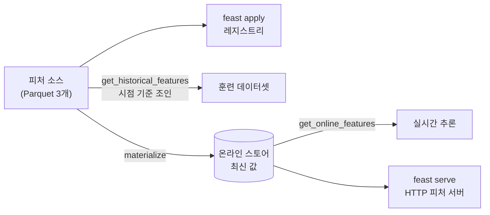
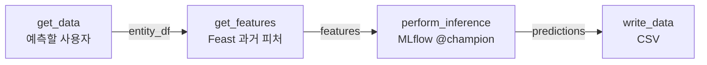

# [MLOps 스터디 2주차] 실험 추적·피처 스토어·파이프라인을 맥북 로컬에서 한 바퀴

## TL;DR

- **4장**: 실험을 "기억"이 아니라 **기록**으로 남긴다. MLflow로 데이터셋·파라미터·지표·모델을 런 단위로 쌓고, 가장 좋은 모델을 **레지스트리**에 올려 이름과 별칭(`@champion`)으로 꺼내 쓴다. 피처는 **Feast**에 등록해 훈련(과거 피처)과 서빙(최신 피처)이 같은 정의를 쓰게 한다.
- **5장**: 데이터 읽기 → 피처 조회 → 추론 → 결과 쓰기를 **Kubeflow Pipelines 컴포넌트**로 나누고 파이프라인으로 엮는다. 책은 이것으로 **배치 예측**을 돌린다.
- **실습**: 이번 주는 쿠버네티스 없이 **맥북 로컬**에서 했다. MLflow 서버(SQLite), Feast(Parquet + SQLite), KFP(`kfp.local`)로 책의 흐름을 그대로 한 바퀴 돌렸고, 맥에서만 만나는 함정(포트 5000, `libomp`, `skops`, uv 가상환경의 pip)도 같이 정리했다.

---

## 4장. 신뢰할 수 있는 머신러닝 시스템 설계

### 4.1 MLflow — 실험 추적과 모델 레지스트리

| 개념 | 한 줄 정리 | 책 예제 |
| --- | --- | --- |
| 실험(experiment) | 같은 문제를 푸는 런들의 묶음 | `income-classifier` |
| 런(run) | 훈련 한 번. 파라미터·지표·아티팩트·입력 데이터셋을 기록 | 결정 트리, 랜덤 포레스트, XGBoost |
| `log_input` | 런에 쓴 데이터셋(스키마·행 수·출처)을 기록 | train / test / reference |
| 모델 레지스트리 | 쓸 모델을 **이름 + 버전**으로 관리 | 테스트 AUC 1등 런을 등록 |
| 별칭(alias) | 버전에 붙이는 이름표. 코드는 버전 번호 대신 별칭으로 꺼낸다 | `models:/income-classifier@champion` |

- 데이터는 미국 인구조사 **소득 데이터(UCI Adult)**. 범주형 8개(고용 형태, 학력, 혼인, 직업, 관계, 인종, 성별, 국가)로 연소득 `>50K`를 맞히는 이진 분류다. `<=50K`가 75%라서 **정확도만 보면 안 되고 AUC를 같이 본다**.
- 원-핫 인코딩한 **열 목록과 순서를 저장**해 두는 게 포인트다. 추론할 때 입력을 같은 열 순서로 맞춰야 하기 때문이다(`column_list.pkl`).

### 4.2 Feast — 피처 스토어



| 개념 | 한 줄 정리 |
| --- | --- |
| 엔티티(Entity) | 피처의 주인. 여기서는 `user_id` |
| 피처 뷰(FeatureView) | 피처 묶음 + 소스 + TTL. 책은 `demographic`, `relationship`, `occupation` 세 개 |
| 오프라인 스토어 | 과거 피처. 엔티티 데이터프레임의 **시점 기준(point-in-time)으로 조인**해 훈련 데이터셋을 만든다 |
| 온라인 스토어 | 최신 피처만. `materialize`로 채우고 밀리초 단위로 조회 |
| 피처 서버 | 온라인 스토어를 HTTP로 노출(`feast serve`) |

> 💡 **느낀 점**: 피처 스토어의 핵심은 "저장"보다 **훈련과 서빙이 같은 피처 정의를 쓴다**는 데 있다. 훈련 때는 노트북에서 조인하고 서빙 때는 API에서 다시 계산하는 순간 훈련-서빙 편향이 생긴다.

---

## 5장. 머신러닝 파이프라인 오케스트레이션

- **컴포넌트**: 입력·출력이 정해진 실행 단위. 책은 컴포넌트마다 파이썬 코드 + Dockerfile + 컴포넌트 정의 YAML을 만든다.
- **파이프라인**: `@dsl.pipeline`으로 컴포넌트를 엮고, 한 컴포넌트의 출력 아티팩트(`Dataset`)를 다음 컴포넌트의 입력으로 넘긴다. 파이프라인 파라미터는 실행할 때 바꿀 수 있다.
- **컴파일**: `Compiler().compile()`이 파이프라인을 YAML(IR)로 만들고, 이걸 KFP에 올려 실행한다.
- 책의 예제는 **소득 분류기 배치 추론 파이프라인**: `get_data` → `get_features`(Feast) → `perform_inference`(MLflow 모델) → `write_data`.



> 💡 **느낀 점**: 4장에서 만든 두 저장소(MLflow 레지스트리, Feast)가 5장에서 그대로 **파이프라인의 입력**이 된다. 각 도구를 따로 배울 때보다 "모델은 레지스트리에서, 피처는 피처 스토어에서 꺼낸다"는 연결이 보이는 게 이번 주의 수확.

---

## 실습: 맥북 로컬에서 4~5장 한 바퀴

1주차처럼 kind에 올리면 MinIO·Redis·KFP 설치에 대부분의 시간이 간다. 이번 주는 **도구 자체의 흐름**을 보는 게 목적이라, 쿠버네티스 없이 맥북 로컬 프로세스로 대체했다.

| 책 | 이번 실습 (맥 로컬) |
| --- | --- |
| MLflow on 쿠버네티스 + MinIO | `mlflow server` + SQLite + 로컬 폴더 (포트 **5050**) |
| 모델: 결정 트리, 랜덤 포레스트, **XGBoost** | 결정 트리, 랜덤 포레스트, **HistGradientBoosting** (아래 트러블슈팅 참고) |
| Feast 레지스트리·오프라인: MinIO, 온라인: **Redis** | 레지스트리·온라인: **SQLite 파일**, 오프라인: Parquet 파일 |
| KFP: 컴포넌트마다 도커 이미지, 클러스터에서 실행 | 파이썬 함수 컴포넌트 + **`kfp.local.SubprocessRunner`** (컨테이너 없이 실행) |
| 결과 저장: MinIO | 로컬 CSV |

> 아래 로그는 모두 이 맥북에서 실제로 실행한 결과다. 작업 폴더 경로만 `~/dev/mlops-week02`로 정리했다.

### 실습 환경

| 항목 | 내용 |
| --- | --- |
| 하드웨어 | MacBook Pro, Apple M4 Pro, 메모리 24GB, macOS 26.5 |
| 파이썬 | `uv` 0.10.10 + Python 3.12 (도구마다 가상환경 분리) |
| 버전 | MLflow 3.17.2, scikit-learn 1.9.1, Feast 0.67.0, KFP 2.18.0 |
| 도커·쿠버네티스 | 이번 주는 **필요 없음** |

```text
$ sw_vers -productVersion
26.5
$ sysctl -n machdep.cpu.brand_string
Apple M4 Pro
$ echo "$(( $(sysctl -n hw.memsize) / 1024 / 1024 / 1024 )) GiB"
24 GiB
$ uv --version
uv 0.10.10 (8c730aaad 2026-03-13)
$ lsof -nP -iTCP:5050 -sTCP:LISTEN || echo "5050 free"
5050 free
$ lsof -nP -iTCP:6566 -sTCP:LISTEN || echo "6566 free"
6566 free
```

> MLflow 기본 포트 5000은 쓰지 않는다. 맥의 **AirPlay 수신 모드**가 5000번을 잡고 있다(1주차와 같은 이유).

### Step 1. 데이터 준비

```bash
mkdir -p ~/dev/mlops-week02/data && cd ~/dev/mlops-week02
curl -sSLo data/adult.data https://archive.ics.uci.edu/ml/machine-learning-databases/adult/adult.data
```

```python
# prepare_data.py — UCI Adult → 책(4.1)과 같은 모양: 범주형 8개 + Target, 결측('?') 행 제거
import pandas as pd
cols = ["Age","Workclass","fnlwgt","Education","Education_num","Marital-Status","Occupation",
        "Relationship","Race","Sex","Capital_gain","Capital_loss","Hours_per_week","Native_country","Target"]
df = pd.read_csv("data/adult.data", header=None, names=cols, skipinitialspace=True, na_values="?")
df = df[["Workclass","Education","Marital-Status","Occupation","Relationship","Race","Sex","Native_country","Target"]].dropna()
df.to_csv("data/income_data.csv", index=False)
print(df.shape); print(df["Target"].value_counts().to_string())
```

```text
$ wc -l data/adult.data
   32562 data/adult.data
$ python prepare_data.py
(30162, 9)
Target
<=50K    22654
>50K      7508
```

책의 `income_data.csv`와 같은 30,162행, `<=50K` 22,654건이 나왔다.

### Step 2. MLflow 서버 (로컬)

```bash
uv venv --seed --python 3.12 .venv-mlflow && source .venv-mlflow/bin/activate   # --seed: pip 포함 (중요, 트러블슈팅 3)
uv pip install mlflow==3.17.2 scikit-learn pandas
mlflow server --host 127.0.0.1 --port 5050 \
  --backend-store-uri sqlite:///mlflow.db --artifacts-destination ./mlartifacts &
```

```text
Registry store URI not provided. Using backend store URI.
2026/11/01 00:51:14 INFO mlflow.store.db.utils: Creating initial MLflow database tables...
[MLflow] Security middleware enabled with default settings (localhost-only). ...
2026/11/01 00:51:15 INFO:     Uvicorn running on http://127.0.0.1:5050 (Press CTRL+C to quit)
$ curl -s http://127.0.0.1:5050/health; echo
OK
$ curl -s http://127.0.0.1:5050/version; echo
3.17.2
```

### Step 3. 세 모델 훈련과 기록 (4.1.2)

```python
# train.py (핵심 부분)
mlflow.set_tracking_uri("http://127.0.0.1:5050")
mlflow.set_experiment("income-classifier")

df = pd.read_csv("data/income_data.csv")
y = (df.pop("Target") == ">50K").astype(int)
X = pd.get_dummies(df, drop_first=True, dtype=float)
pickle.dump(X.columns.to_list(), open("column_list.pkl", "wb"))       # 추론 때 열 순서 맞추기용
X_train, X_test, y_train, y_test = train_test_split(X, y, train_size=0.8, shuffle=True, random_state=42)

# MLflow 3.17 은 sklearn 모델을 skops 로 저장 → 트리 계열은 신뢰 형식을 적어야 한다 (트러블슈팅 2)
TREE = ["sklearn.tree._tree.Tree"]
HGB = ["sklearn.ensemble._hist_gradient_boosting.predictor.TreePredictor"]
models = {
    "decision-tree": (DecisionTreeClassifier(random_state=42), TREE),
    "random-forest": (RandomForestClassifier(n_estimators=200, max_depth=12, random_state=42, n_jobs=-1), TREE),
    "hist-gradient-boosting": (HistGradientBoostingClassifier(max_iter=200, learning_rate=0.1, random_state=42), HGB),
}
for name, (model, trusted) in models.items():
    with mlflow.start_run(run_name=name):
        mlflow.log_input(mlflow.data.from_pandas(X_train.assign(Target=y_train), source="data/income_data.csv", name="income-train"), context="training")
        mlflow.log_input(mlflow.data.from_pandas(X_test.assign(Target=y_test), source="data/income_data.csv", name="income-test"), context="testing")
        mlflow.log_params(model.get_params())
        model.fit(X_train, y_train)
        mlflow.log_metrics({"roc_auc_test": roc_auc_score(y_test, model.predict_proba(X_test)[:, 1]),
                            "accuracy_train": model.score(X_train, y_train),
                            "accuracy_test": model.score(X_test, y_test)})
        mlflow.log_artifact("column_list.pkl")
        mlflow.sklearn.log_model(model, name="income-classifier", input_example=X_test.head(2), skops_trusted_types=trusted)
```

```text
$ python train.py
2026/11/01 01:51:20 INFO mlflow.tracking.fluent: Experiment with name 'income-classifier' does not exist. Creating a new experiment.
features=90  train=24129  test=6033
decision-tree            auc_test=0.8189  acc_train=0.8638  acc_test=0.8137  fit=0.1s
random-forest            auc_test=0.8732  acc_train=0.8340  acc_test=0.8245  fit=0.2s
hist-gradient-boosting   auc_test=0.8778  acc_train=0.8327  acc_test=0.8274  fit=0.8s
```

UI(`http://localhost:5050`) 대신 터미널로 런을 비교하면:

```text
   tags.mlflow.runName  metrics.roc_auc_test  metrics.accuracy_test  metrics.fit_seconds   status
hist-gradient-boosting                0.8778                 0.8274               0.7859 FINISHED
         random-forest                0.8732                 0.8245               0.1996 FINISHED
         decision-tree                0.8189                 0.8137               0.0651 FINISHED

$ ls mlartifacts/1/models/*/artifacts
conda.yaml
input_example.json
MLmodel
model.skops
python_env.yaml
requirements.txt
serving_input_example.json
```

- 결정 트리는 훈련 정확도(0.86)가 테스트(0.81)보다 눈에 띄게 높다 → **과적합**. 깊이를 제한한 랜덤 포레스트와 부스팅이 AUC가 높다.
- 모델은 `model.skops` + 환경 파일(`requirements.txt`, `conda.yaml`) + `MLmodel`로 저장된다. 다른 곳에서 같은 환경으로 다시 불러올 수 있게 해 주는 정보다.

### Step 4. 모델 레지스트리와 별칭 (4.1.3)

```python
# register.py (핵심 부분)
best = client.search_runs([exp.experiment_id], order_by=["metrics.roc_auc_test DESC"], max_results=1)[0]
mv = mlflow.register_model(f"runs:/{best.info.run_id}/income-classifier", "income-classifier")
client.set_registered_model_alias("income-classifier", "champion", mv.version)

model = mlflow.sklearn.load_model("models:/income-classifier@champion")
X = pd.get_dummies(people, dtype=float).reindex(columns=cols, fill_value=0.0)   # 훈련 때 열 순서로 맞춘다
```

```text
$ python register.py
Successfully registered model 'income-classifier'.
2026/11/01 01:51:30 WARNING mlflow.tracking._model_registry.fluent: Run with id 79bd4aa7acb24ee7871851269d2cb1fd has no artifacts at artifact path 'income-classifier', registering model based on models:/m-b53dfd0fc747475689b5a1279f30dc81 instead
Created version '1' of model 'income-classifier'.
best run: hist-gradient-boosting  roc_auc_test=0.8778
registered: income-classifier v1  alias=champion
  Masters·관리직·기혼 P(>50K) = 0.865
  고졸·단순노무·미혼     P(>50K) = 0.004
```

- 경고는 **MLflow 3의 변화** 때문이다. 모델이 런의 아티팩트가 아니라 별도의 "LoggedModel"(`models:/m-…`)로 저장되므로, 책의 `runs:/<run_id>/<이름>` 주소를 MLflow가 알아서 바꿔 등록했다. 새로 쓰는 코드라면 `log_model`이 돌려주는 `model_info.model_uri`를 쓰면 경고가 없다.
- 이후 코드는 버전 번호(`/1`) 대신 **`@champion`** 으로 꺼낸다. 새 모델이 더 좋으면 별칭만 옮기면 되고, 추론 코드는 바꿀 필요가 없다.

### Step 5. Feast — 피처 등록과 과거 피처 조회 (4.2.1~4.2.2)

책처럼 "피처가 여러 시스템에 흩어져 있다"는 상황을 만들려고, 한 파일을 Parquet 세 개로 나눴다(`user_id` = 행 번호, 시점은 2026-10-01).

```text
$ python make_feature_data.py
demographic_features.parquet  (30162, 5)  ['Native_country', 'Sex', 'Race']
relationship_features.parquet  (30162, 4)  ['Relationship', 'Marital_status']
occupation_features.parquet  (30162, 5)  ['Workclass', 'Education', 'Occupation']
```

```yaml
# feature_repo/feature_store.yaml
project: income
registry: data/registry.db          # 책: MinIO(s3://feature-registry/...) → 로컬 파일
provider: local
offline_store:
  type: file                        # Parquet 파일
online_store:
  type: sqlite                      # 책: Redis → 로컬 SQLite
  path: data/online_store.db
entity_key_serialization_version: 3
```

```python
# feature_repo/features.py
user = Entity(name="user_id", value_type=ValueType.INT64, description="A user")

def view(name, cols):
    return FeatureView(name=name, entities=[user],
                       schema=[Field(name=c, dtype=String) for c in cols],
                       ttl=timedelta(days=365),
                       source=FileSource(path=f"data/{name}_features.parquet", timestamp_field="event_timestamp"))

demographic = view("demographic", ["Native_country", "Sex", "Race"])
relationship = view("relationship", ["Relationship", "Marital_status"])
occupation = view("occupation", ["Workclass", "Education", "Occupation"])
```

```text
$ uv pip install feast==0.67.0     # 별도 가상환경 .venv-feast
$ cd feature_repo && feast apply
Applying changes for project income
Created project income
Created entity user_id
Created feature view relationship
Created feature view occupation
Created feature view demographic

Created sqlite table income_demographic
Created sqlite table income_occupation
Created sqlite table income_relationship

$ feast feature-views list
NAME          ENTITIES     TYPE         ENABLED    STATE
relationship  {'user_id'}  FeatureView  Yes        STATE_UNSPECIFIED
occupation    {'user_id'}  FeatureView  Yes        STATE_UNSPECIFIED
demographic   {'user_id'}  FeatureView  Yes        STATE_UNSPECIFIED

$ cd .. && python get_training_df.py      # 정답 테이블(user_id, 시점, Target)에 세 피처 뷰를 시점 기준 조인
(30162, 11)
 user_id Target Native_country    Sex  Race  Relationship     Marital_status Workclass    Education   Occupation
       0  <=50K  United-States   Male White Not-in-family      Never-married State-gov    Bachelors Adm-clerical
   20117   >50K  United-States   Male White       Husband Married-civ-spouse   Private   Assoc-acdm Craft-repair
   20090  <=50K  United-States Female White Not-in-family           Divorced Local-gov Some-college Adm-clerical
```

세 파일로 흩어진 피처가 다시 한 장의 훈련 데이터셋(30,162행)으로 모였다.

### Step 6. 온라인 스토어와 피처 서버 (4.2.2~4.2.3)

```text
$ cd feature_repo && feast materialize-incremental 2026-11-01T00:00:00
Materializing 3 feature views to 2026-11-01 00:00:00+00:00 into the sqlite online store.

relationship from 2025-10-31 16:56:15+00:00 to 2026-11-01 00:00:00+00:00:
occupation from 2025-10-31 16:56:15+00:00 to 2026-11-01 00:00:00+00:00:
demographic from 2025-10-31 16:56:15+00:00 to 2026-11-01 00:00:00+00:00:

$ cd .. && python get_online.py
user_id         [0, 20117]
Sex             ['Male', 'Male']
Education       ['Bachelors', 'Assoc-acdm']
Occupation      ['Adm-clerical', 'Craft-repair']
Marital_status  ['Never-married', 'Married-civ-spouse']
```

- 시작 시점이 "지금 − TTL(365일)"로 잡힌다. TTL보다 오래된 피처는 온라인 스토어에 올라가지 않는다.
- 온라인 스토어 SQLite 파일은 46MB였다. 책에서 이 자리가 Redis다.

```text
$ cd feature_repo && feast serve --host 127.0.0.1 --port 6566 &
WARNING:feast.permissions.server.utils:Running with auth_type=no_auth. All endpoints are unauthenticated. This is suitable for local development only. ...
[2026-11-01 01:53:44 +0900] [41882] [INFO] Listening at: http://127.0.0.1:6566 (41882)

$ curl -s -X POST localhost:6566/get-online-features -H 'Content-Type: application/json' \
    -d '{"features":["demographic:Sex","occupation:Occupation"],"entities":{"user_id":[0,20117]}}'
(응답에서 이름·값·상태만 추림)
{
  "feature_names": ["user_id", "Sex", "Occupation"],
  "values": [[0, 20117], ["Male", "Male"], ["Adm-clerical", "Craft-repair"]],
  "statuses": [["PRESENT", "PRESENT"], ["PRESENT", "PRESENT"], ["PRESENT", "PRESENT"]]
}
```

> ⚠️ 피처 서버는 기본이 **인증 없음**이다(경고 그대로). 로컬에서만 쓰고, 운영에서는 OIDC 등을 붙인다.

### Step 7. 배치 추론 파이프라인을 `kfp.local`로 (5장)

책은 컴포넌트마다 도커 이미지를 만들어 클러스터에서 돌린다. KFP 2.x의 **`kfp.local`** 을 쓰면 같은 파이프라인 코드를 **맥에서 하위 프로세스로** 실행해 볼 수 있다. 컴파일한 YAML은 나중에 KFP 클러스터에 그대로 올리면 된다.

```python
# pipeline.py (핵심 부분)
@dsl.component(packages_to_install=["feast==0.67.0"])
def get_features(repo_path: str, entity_df: Input[Dataset], features: Output[Dataset]):
    import pandas as pd
    from feast import FeatureStore
    df = FeatureStore(repo_path=repo_path).get_historical_features(
        entity_df=pd.read_parquet(entity_df.path),
        features=["demographic:Native_country", "demographic:Sex", "demographic:Race",
                  "relationship:Relationship", "relationship:Marital_status",
                  "occupation:Workclass", "occupation:Education", "occupation:Occupation"]).to_df()
    df.to_parquet(features.path, index=False)

@dsl.component(packages_to_install=["mlflow==3.17.2", "scikit-learn", "pandas"])
def perform_inference(tracking_uri: str, model_uri: str, columns_path: str,
                      features: Input[Dataset], predictions: Output[Dataset]):
    import pickle, mlflow, pandas as pd
    mlflow.set_tracking_uri(tracking_uri)
    model = mlflow.sklearn.load_model(model_uri)            # models:/income-classifier@champion
    ...

@dsl.pipeline(name="income-classifier-batch", description="Feast 피처 + MLflow 모델로 배치 예측")
def income_classifier_pipeline(labels_path: str, repo_path: str, tracking_uri: str, columns_path: str,
                               output_csv: str, n_users: int = 100,
                               model_uri: str = "models:/income-classifier@champion"):
    data = get_data(labels_path=labels_path, n_users=n_users)
    feats = get_features(repo_path=repo_path, entity_df=data.outputs["entity_df"])
    preds = perform_inference(tracking_uri=tracking_uri, model_uri=model_uri, columns_path=columns_path,
                              features=feats.outputs["features"])
    write_data(predictions=preds.outputs["predictions"], output_csv=output_csv)

if __name__ == "__main__":
    compiler.Compiler().compile(income_classifier_pipeline, "income_classifier_pipeline.yaml")
    local.init(runner=local.SubprocessRunner(use_venv=False), pipeline_root="local_outputs")   # 컨테이너 없이
    income_classifier_pipeline(...)
```

```text
$ uv pip install kfp==2.18.0 feast==0.67.0 mlflow==3.17.2 scikit-learn pandas    # .venv-kfp
kfp 2.18.0 | feast 0.67.0 | mlflow 3.17.2 | sklearn 1.9.1

$ python pipeline.py
compiled: income_classifier_pipeline.yaml
01:55:08.573 - INFO - Running pipeline: 'income-classifier-batch'
01:55:08.578 - INFO - Executing task 'get-data'
    entity_df: 100 users
01:55:09.755 - INFO - Task 'get-data' finished with status SUCCESS
01:55:09.756 - INFO - Executing task 'get-features'
    features: (100, 10)
01:55:12.825 - INFO - Task 'get-features' finished with status SUCCESS
01:55:12.826 - INFO - Executing task 'perform-inference'
    predictions: 100 rows, >50K = 17
01:55:27.892 - INFO - Task 'perform-inference' finished with status SUCCESS
01:55:27.893 - INFO - Executing task 'write-data'
    wrote ~/dev/mlops-week02/predictions.csv
     user_id  prob_over_50k prediction
         474         0.0807      <=50K
         905         0.0926      <=50K
         942         0.7408       >50K
        1169         0.0235      <=50K
        1592         0.0311      <=50K
01:55:28.627 - INFO - Task 'write-data' finished with status SUCCESS
01:55:28.627 - INFO - Pipeline 'income-classifier-batch' finished with status SUCCESS
```

(각 태스크의 `executor_input` JSON 출력은 길어서 뺐다.)

```text
$ ls local_outputs/income-classifier-batch-*/
get-data
get-features
perform-inference
write-data

$ head -12 income_classifier_pipeline.yaml
# PIPELINE DEFINITION
# Name: income-classifier-batch
# Description: Feast 피처 + MLflow 모델로 배치 예측
# Inputs:
#    columns_path: str
#    labels_path: str
#    model_uri: str [Default: 'models:/income-classifier@champion']
#    n_users: int [Default: 100.0]
#    output_csv: str
#    repo_path: str
#    tracking_uri: str
components:

$ python -c "...predictions.csv 와 정답 비교..."
rows=100  accuracy=0.75  예측>50K=17  실제>50K=28
```

- 4단계가 20초 만에 끝났다. 태스크마다 `local_outputs/` 아래에 아티팩트 폴더가 생겨서, 단계 사이에 무엇이 넘어갔는지 직접 열어 볼 수 있다.
- 100명 샘플의 정확도 0.75는 테스트셋(0.83)보다 낮다. 샘플이 작아 흔들린 것이고, 모델이 `>50K`를 보수적으로 예측하는 경향(17 vs 28)도 보인다. 임계값 0.5를 낮추는 실험을 해 볼 만하다.

### 트러블슈팅 — 맥에서 실제로 걸린 것들

| # | 증상 | 원인 | 해결 |
| --- | --- | --- | --- |
| 1 | `import xgboost` → `XGBoostError: ... Library not loaded: @rpath/libomp.dylib` | 맥용 XGBoost는 OpenMP 런타임이 필요 | `brew install libomp`. 이번에는 시스템 패키지를 늘리지 않으려고 scikit-learn의 `HistGradientBoostingClassifier`로 대체 |
| 2 | `log_model` → `UntrustedTypesFoundException: ... ['sklearn.tree._tree.Tree']` | MLflow 3.17은 sklearn 모델을 **skops**로 저장하고, 트리 계열 내부 형식은 명시적으로 신뢰해야 함 | 직접 훈련한 모델이므로 `skops_trusted_types=[...]`에 필요한 형식만 지정(위 `train.py`) |
| 3 | 모델 하나 기록에 **17분** (`Failed to resolve installed pip version` 경고 직후 멈춤) | `uv venv`로 만든 가상환경에는 **pip가 없음** → MLflow의 의존성 추정이 매우 느려짐 | `uv venv --seed`로 만들거나 `uv pip install pip`. 설치 후 같은 작업이 1.9초, `pip_requirements=[...]`를 직접 주면 0.5초 |
| 4 | `feast apply` 출력에 엉뚱한 데이터프레임이 찍힘 | `feast apply`가 피처 저장소 폴더의 **모든 `.py`를 import** 해서, 같은 폴더에 둔 조회 스크립트까지 실행 | 조회·실험 스크립트는 `feature_repo` 밖에 둔다(또는 `.feastignore`) |
| 5 | MLflow를 5000번으로 띄우면 이상한 응답 | AirPlay 수신 모드가 5000번 사용 | 5050 사용, 또는 AirPlay 수신 끄기 |

```text
# 3번의 실제 로그 — 경고 사이 간격이 모델 하나 기록 시간
2026/11/01 00:52:20 WARNING mlflow.utils.environment: Failed to resolve installed pip version. ``pip`` will be added to conda.yaml environment spec without a version specifier.
2026/11/01 01:09:44 WARNING mlflow.utils.environment: Failed to resolve installed pip version. ``pip`` will be added to conda.yaml environment spec without a version specifier.
2026/11/01 01:27:27 WARNING mlflow.utils.environment: Failed to resolve installed pip version. ``pip`` will be added to conda.yaml environment spec without a version specifier.
```

### 리소스와 정리

| 항목 | 크기 |
| --- | --- |
| `.venv-mlflow` / `.venv-feast` / `.venv-kfp` | 554MB / 389MB / 720MB |
| MLflow (`mlflow.db` + `mlartifacts/`) | 약 17MB |
| Feast 데이터 (Parquet + SQLite) | 47MB |

도커 VM이나 클러스터 없이 프로세스 몇 개만 띄우므로, 1주차 kind 구성(약 10GiB)보다 훨씬 가볍다. 가상환경을 도구별로 나눈 만큼 디스크는 1.7GB 정도 쓴다.

```bash
pkill -f "mlflow server --host 127.0.0.1 --port 5050"
pkill -f "feast serve"
rm -rf ~/dev/mlops-week02      # 가상환경까지 지우려면
```

---

## 다음 주에 해 볼 것

- 이번 주 로컬 흐름을 **kind 클러스터 위로** 옮기기: 따로 진행 중인 kind 실습에서 MLflow를 PostgreSQL + S3Proxy + 키클락(OIDC)으로 **다중 사용자·프로젝트별 워크스페이스** 구성까지 올려 두었다. 여기에 Feast(Redis)와 KFP를 붙여 책의 구성에 가깝게 만든다.
- 6장(모델 프로덕션화): 같은 `@champion` 모델을 **BentoML로 실시간 서빙**, KFP 파이프라인은 정기 실행(Recurring Run)으로 배치 예측.
