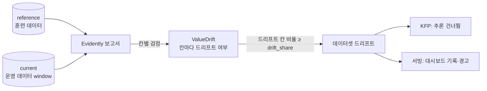
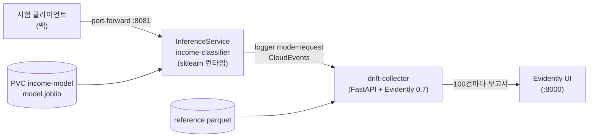

# [MLOps 스터디 3주차] 모델 서빙과 드리프트 감시 — KServe + Evidently 0.7 설치·시험 절차

- **6.1 (BentoML)**: 모델과 추론 코드·의존성을 **벤토**로 묶어 이미지로 만들고 배포한다. 책은 배포에 Yatai를 쓴다.
- **6.2 (Evidently)**: 훈련 데이터(reference)와 운영 데이터(current)를 비교해 **데이터 드리프트**를 잡는다. 보고서·대시보드, KFP 컴포넌트(배치 앞단 차단), API 서빙 쪽 감시 세 군데에 붙인다.
- **이번 주 실습 설계**: 책의 BentoML + Yatai 대신 **KServe 기본 런타임(Standard 모드, BentoML 없음)** 으로 서빙하고, KServe의 **요청 로거**가 보내는 요청을 모아 **100건마다 Evidently 0.7 보고서**를 만든다. 배치 쪽은 KFP `dsl.If`로 드리프트면 추론을 건너뛴다.


---

## 6장. 머신러닝 모델 프로덕션화

### 6.1 배포 플랫폼으로서의 BentoML

| 단계 | 하는 일 | 책 |
| --- | --- | --- |
| 벤토 빌드 | 모델 + 서비스 코드(`service.py`) + 의존성(`bentofile.yaml`)을 한 묶음으로 | `bentoml build` |
| 이미지화·푸시 | 벤토를 컨테이너 이미지로 만들어 레지스트리에 올림 | `bentoml containerize` |
| 배포 | 쿠버네티스에 배포하고 스케일 관리 | Yatai |

- BentoML의 장점은 **API 서버 코드를 거의 쓰지 않아도 된다**는 점이다. 입출력 형식, 배치 처리, 워커 수를 데코레이터로 정한다.
- 책의 Yatai는 빌드부터 배포까지 다 맡지만, 오래된 BentoML(1.1.x)에 묶여 있다. 참고한 글은 그래서 **Yatai만 빼고 BentoML은 1.4.40으로 올려 계속 썼다.** 벤토 이미지는 CI(러너)에서 빌드하고, 배포는 KServe InferenceService에 그 이미지를 올리는 방식이다.
- 이번 주 실습은 한 걸음 더 나가 **BentoML 없이 KServe 기본 런타임**(sklearn)으로 서빙했다. 둘의 차이는 아래에 정리했다.

### KServe 기본 런타임 vs BentoML + KServe

둘 다 쿠버네티스에 올리는 건 **KServe**다. 차이는 **모델 서버 프로그램을 누가 만드느냐**에 있다.

- **KServe 기본 런타임**: KServe가 미리 만들어 둔 서버 이미지에 **모델 파일만 넣는다.** 서버 코드를 쓰지 않는다.
- **BentoML + KServe**: **내가 쓴 서버 코드(BentoML 서비스)** 를 이미지로 만들고, KServe는 그 이미지를 띄워 주기만 한다.

```text
기본 런타임:   [KServe sklearn 서버 이미지] + model.joblib (PVC)  →  KServe 가 배포
BentoML:      [service.py + 모델 + 의존성 → 벤토 이미지]          →  KServe 가 배포 (containers 로 지정)
```

| | KServe 기본 런타임 | BentoML + KServe |
| --- | --- | --- |
| 준비할 것 | 모델 파일 하나(`model.joblib`) | `service.py`, `bentofile.yaml`, 이미지 빌드 |
| 입력 형식 | 런타임이 정한 형식(`{"instances": [[...], ...]}`)을 따른다 | 직접 정한다 (예: 이름 붙은 JSON `{"workclass": "Private", ...}`) |
| 전처리·후처리 | 모델 안에 넣어야 한다 (그래서 인코딩까지 `Pipeline`으로 묶음) | 서비스 코드에서 자유롭게 (입력 검증, 변환, 응답 가공) |
| 라이브러리 버전 | **런타임 이미지의 버전에 맞춰** 훈련해야 한다 (sklearn 버전 맞추기) | 내가 고정한 버전이 이미지에 그대로 들어간다 |
| 드리프트 감시 같은 부가 기능 | 서버 밖에 따로 만든다 (logger → collector) | 서비스 코드 안에 바로 넣을 수 있다 |
| 이미지 빌드·레지스트리 | 필요 없다 | 필요하다 (빌드 후 푸시, kind 는 `kind load`) |
| 지원 모델 | KServe가 지원하는 형식(sklearn, XGBoost, PyTorch, Hugging Face 등) | 파이썬으로 돌릴 수 있으면 무엇이든 |
| 관리할 코드 | 적다 | 서비스 코드와 이미지 빌드 과정을 관리해야 한다 |

**언제 무엇을 쓰나**

- **기본 런타임**: 모델이 표준 형식이고 입력을 그대로 넣으면 끝날 때. 빨리 올리고 관리할 코드를 줄이고 싶을 때.
- **BentoML**: 입력 검증·전처리·여러 모델 조합·응답 가공처럼 **서버에 로직이 필요할 때**. 훈련 환경과 같은 라이브러리 버전을 이미지에 고정해 두고 싶을 때.

참고한 글은 BERT 모델이라 토크나이저 전처리가 필요하고, 드리프트용 수치(`url_stats`)도 서버에서 계산해야 했다. 그래서 BentoML이 필요했다. 소득 분류기는 표 데이터 + sklearn이라 기본 런타임으로도 충분하다. 다만 이렇게 하면 **책 6.1(BentoML)은 실습에서 빠진다.** 다음에 실제로 설치할 때 BentoML + KServe 구성을 함께 시험해 비교할 예정이다.

> 💡 **느낀 점**: "BentoML이냐 KServe냐"로 생각했는데, 실제로는 겹치지 않는다. **BentoML은 서버를 만드는 도구, KServe는 서버를 쿠버네티스에 올리고 관리하는 도구**다. Yatai가 하던 일(배포)을 KServe가 대신할 뿐, 서버 코드가 필요하면 BentoML은 여전히 쓸모가 있다.

### 6.2 데이터 드리프트 모니터링을 위한 Evidently



| 개념 | 한 줄 정리 |
| --- | --- |
| 데이터 드리프트 | 입력 분포가 훈련 때와 달라짐. 정답 없이도 바로 잡을 수 있다 |
| 판정 2단계 | ① 칸마다 통계 검정 → ② 드리프트 칸 비율이 `drift_share`(기본 0.5) 이상이면 데이터셋 드리프트 |
| 붙이는 곳 | 보고서·대시보드(6.2.1), KFP 컴포넌트(6.2.2), API로 배포된 모델(6.2.3) |

**책(Evidently 0.5)과 0.7의 이름 차이** — 책 코드를 그대로 쓰면 import부터 실패한다.

| 책 (0.5) | 0.7 |
| --- | --- |
| `DatasetDriftMetric` | `DriftedColumnsCount` |
| `ColumnDriftMetric` | `ValueDrift(column=…)` |
| `Report(metrics=[...])` + `ColumnMapping` | `Report([...])` + `Dataset.from_pandas(df, data_definition=DataDefinition(...))` |
| `report.run(...)` 후 `report.as_dict()` | `snapshot = report.run(...)` 후 `snapshot.dict()` |

**검정 방식이 결과를 바꾼다.** Evidently는 칸 종류와 행 수에 따라 기본 검정을 고른다. 참고한 글은 수치 칸에서 기본 검정(Wasserstein 기반)이 **같은 분포끼리 비교해도 드리프트를 자주 판정**해서 KS 검정으로 바꿨다. 소득 데이터는 **범주형 8칸**이라 기본은 카이제곱 계열이고, 비교 후보는 Jensen-Shannon, PSI다. 이번 주 시험 항목에 같은 비교를 넣었다.

> 💡 **느낀 점**: 드리프트 탐지는 "켜 두면 알아서 잡는다"가 아니다. **같은 분포에서 얼마나 자주 잘못 울리는지(오탐)** 를 먼저 재고 검정과 window 크기를 정해야, 경보를 믿을 수 있다.

---

## 실습 설계: kind + KServe + Evidently

### 구성



| 구성 요소 | 네임스페이스 | 버전·설정 |
| --- | --- | --- |
| kind 클러스터 `week03` | — | kind v0.33.0, control-plane 1 + worker 1 |
| cert-manager | `cert-manager` | v1.21.3 (KServe 웹훅 인증서) |
| KServe | `kserve` | v0.21.0, **Standard 모드**(Knative·Istio 없이 Deployment + Service로 배포) |
| 모델 | `serving` | 2주차 소득 분류기를 `Pipeline(OneHotEncoder → HistGradientBoosting)`로 다시 저장 |
| drift-collector | `monitoring` | Python 3.12, FastAPI, Evidently 0.7.23 |
| Evidently UI | `monitoring` | `evidently ui` (포트 8000) |

**책과 다른 점**

| 책 | 이번 설계 | 이유 |
| --- | --- | --- |
| BentoML + Yatai로 배포 | KServe InferenceService (sklearn **기본 런타임**, BentoML 없음) | Yatai는 BentoML 1.1.x에 묶임. 표 데이터 + sklearn이라 서버 코드 없이 모델 파일만으로 서빙 가능 (참고 글은 BentoML 1.4 + KServe — 위 비교 참고) |
| 서빙 코드 안에서 드리프트 계산 | KServe **logger**가 요청을 따로 보내고, 별도 서비스가 계산 | 추론 지연에 영향을 주지 않고, 모델을 바꿔도 감시는 그대로 |
| Evidently 0.5 | 0.7.23 | 최신 안정판. API 이름이 바뀜(위 표) |

### 시험 항목

| ID | 시험 | 판정 기준 |
| --- | --- | --- |
| T-01 | 클러스터·cert-manager·KServe 설치 | 컨트롤러 파드 Running, CRD 등록 |
| T-02 | InferenceService 배포 | `READY=True`, predictor 파드 1/1 |
| T-03 | 추론 요청 | 2명 입력에 확률 2쌍 응답 |
| T-04 | 요청 로거 전달 | drift-collector 로그에 수신 건수 증가 |
| T-05 | 같은 분포 window의 오탐률 | 검정별 오탐률 비교, 5% 안팎인 검정을 채택 |
| T-06 | 바뀐 분포 window 탐지 | 드리프트 칸이 `drift_share` 이상 → 데이터셋 드리프트 |
| T-07 | Evidently UI 기록 | 프로젝트에 window별 보고서가 쌓임 |
| T-08 | KFP `dsl.If` 차단 | 드리프트면 추론 태스크가 실행되지 않음 |

---

## 설치 절차

### Step 0. 준비

```bash
brew install kind kubectl helm
mkdir -p ~/dev/mlops-week03 && cd ~/dev/mlops-week03
```

```text
# 예시 출력
$ kind version
kind v0.33.0 go1.27.0 darwin/arm64
$ helm version --short
v3.19.0+g3d8990f
$ docker info --format '{{.NCPU}} CPUs / {{.MemTotal}} bytes'
12 CPUs / 17179869184 bytes
```

> 맥은 5000번 포트를 AirPlay가 쓴다. 이 글은 추론 8081, Evidently UI 8000을 쓴다.

### Step 1. kind 클러스터 (T-01)

```yaml
# kind-week03.yaml
kind: Cluster
apiVersion: kind.x-k8s.io/v1alpha4
name: week03
nodes:
  - role: control-plane
  - role: worker
```

```bash
kind create cluster --config kind-week03.yaml
kubectl get nodes
```

```text
# 예시 출력
NAME                   STATUS   ROLES           AGE   VERSION
week03-control-plane   Ready    control-plane   58s   v1.36.4
week03-worker          Ready    <none>          41s   v1.36.4
```

### Step 2. cert-manager (T-01)

KServe는 웹훅용 인증서를 cert-manager로 만든다.

```bash
helm install cert-manager oci://quay.io/jetstack/charts/cert-manager --version v1.21.3 \
  -n cert-manager --create-namespace --set crds.enabled=true
kubectl rollout status deploy/cert-manager-webhook -n cert-manager --timeout=180s
```

```text
# 예시 출력
NAME: cert-manager
NAMESPACE: cert-manager
STATUS: deployed
REVISION: 1
deployment "cert-manager-webhook" successfully rolled out
```

### Step 3. KServe (Standard 모드) (T-01)

Standard 모드는 InferenceService를 일반 **Deployment + Service**로 만든다. Knative·Istio가 필요 없어 kind에 가볍게 올릴 수 있다. 외부 노출(인그레스)은 쓰지 않고 `port-forward`로 접속한다.

```bash
kubectl apply -f https://github.com/kubernetes-sigs/gateway-api/releases/download/v1.2.1/standard-install.yaml

helm install kserve-crd oci://ghcr.io/kserve/charts/kserve-crd --version v0.21.0 \
  -n kserve --create-namespace
helm install kserve oci://ghcr.io/kserve/charts/kserve-resources --version v0.21.0 -n kserve \
  --set kserve.controller.deploymentMode=Standard \
  --set kserve.controller.gateway.ingressGateway.enableGatewayApi=true \
  --set kserve.controller.gateway.ingressGateway.kserveGateway=kserve/kserve-ingress-gateway

kubectl get pods -n kserve
kubectl get crd | grep serving.kserve.io
```

```text
# 예시 출력
NAME                                         READY   STATUS    RESTARTS   AGE
kserve-controller-manager-7d9c6b8f5c-4kq2x   2/2     Running   0          64s

clusterservingruntimes.serving.kserve.io     2026-11-07T05:12:40Z
inferencegraphs.serving.kserve.io            2026-11-07T05:12:40Z
inferenceservices.serving.kserve.io          2026-11-07T05:12:40Z
servingruntimes.serving.kserve.io            2026-11-07T05:12:40Z
trainedmodels.serving.kserve.io              2026-11-07T05:12:40Z
```

- Gateway API CRD는 컨트롤러가 라우트 리소스를 만들 때 필요해서 넣는다. Gateway 구현체(Envoy Gateway 등)는 설치하지 않으므로 외부 경로는 동작하지 않고, 접속은 `port-forward`로 한다.

### Step 4. 모델 준비와 PVC 업로드 (T-02)

KServe sklearn 런타임은 `model.joblib`을 그대로 불러 `predict_proba`를 부른다. 2주차처럼 `get_dummies`를 바깥에서 하면 서버에 보낼 입력을 90칸으로 맞춰야 하므로, **인코딩까지 포함한 Pipeline**으로 저장해 원래 범주형 8칸을 그대로 보내게 했다.

```python
# train_pipeline.py
import joblib, pandas as pd
from sklearn.compose import ColumnTransformer
from sklearn.ensemble import HistGradientBoostingClassifier
from sklearn.pipeline import Pipeline
from sklearn.preprocessing import OneHotEncoder

COLS = ["Workclass", "Education", "Marital-Status", "Occupation", "Relationship", "Race", "Sex", "Native_country"]
df = pd.read_csv("data/income_data.csv")          # 2주차 Step 1에서 만든 파일
y = (df.pop("Target") == ">50K").astype(int)

pipe = Pipeline([
    ("onehot", ColumnTransformer([("cat", OneHotEncoder(handle_unknown="ignore"), list(range(8)))])),
    ("model", HistGradientBoostingClassifier(max_iter=200, random_state=42)),
])
pipe.fit(df[COLS].to_numpy(dtype=object), y)       # 서버는 이름 없는 배열을 넘기므로 열 번호로 인코딩
joblib.dump(pipe, "model/model.joblib")
df[COLS].sample(5000, random_state=1).to_parquet("model/reference.parquet", index=False)   # 드리프트 reference
```

> 런타임 이미지 안의 scikit-learn 버전과 훈련 버전을 맞춘다. 다르면 `InconsistentVersionWarning`이나 불러오기 실패가 난다. 확인: `kubectl exec <predictor 파드> -- pip show scikit-learn`

```yaml
# model-pvc.yaml — 모델 파일을 올려 둘 PVC 와 복사용 임시 파드
apiVersion: v1
kind: Namespace
metadata: { name: serving }
---
apiVersion: v1
kind: PersistentVolumeClaim
metadata: { name: income-model, namespace: serving }
spec:
  accessModes: ["ReadWriteOnce"]
  resources: { requests: { storage: 1Gi } }
---
apiVersion: v1
kind: Pod
metadata: { name: model-copy, namespace: serving }
spec:
  containers:
    - name: c
      image: busybox:1.37
      command: ["sleep", "3600"]
      volumeMounts: [{ name: m, mountPath: /mnt/models }]
  volumes:
    - name: m
      persistentVolumeClaim: { claimName: income-model }
```

```bash
kubectl apply -f model-pvc.yaml
kubectl wait --for=condition=Ready pod/model-copy -n serving --timeout=120s
kubectl exec -n serving model-copy -- mkdir -p /mnt/models/model
kubectl cp model/model.joblib serving/model-copy:/mnt/models/model/model.joblib
kubectl delete pod model-copy -n serving       # RWO 이므로 predictor 가 쓰기 전에 지운다
```

### Step 5. InferenceService 배포 (T-02)

```yaml
# income-isvc.yaml
apiVersion: serving.kserve.io/v1beta1
kind: InferenceService
metadata:
  name: income-classifier
  namespace: serving
spec:
  predictor:
    minReplicas: 1
    maxReplicas: 1
    logger:
      mode: request                      # 요청만 보낸다 (응답까지면 all)
      url: http://drift-collector.monitoring.svc.cluster.local/events
    model:
      modelFormat:
        name: sklearn
      protocolVersion: v1
      storageUri: pvc://income-model/model
      env:
        - name: PREDICT_PROBA              # sklearn 런타임: true 면 predict 대신 predict_proba
          value: "true"
      resources:
        requests: { cpu: 200m, memory: 512Mi }
        limits: { memory: 1Gi }
```

```bash
kubectl apply -f income-isvc.yaml
kubectl get isvc -n serving -w
kubectl get pods -n serving
```

```text
# 예시 출력
NAME                URL                                            READY   PREV   LATEST   AGE
income-classifier   http://income-classifier-serving.example.com   True                     71s

NAME                                           READY   STATUS    RESTARTS   AGE
income-classifier-predictor-6c8f9d7b54-2xk9p   2/2     Running   0          71s
```

- 파드가 2/2인 이유: 모델 서버 컨테이너 + **agent 사이드카**(logger를 켜면 붙어서 요청을 복사해 보낸다).

### Step 6. drift-collector와 Evidently UI (T-04, T-07)

KServe logger는 요청마다 CloudEvent(본문 = 요청 JSON)를 POST로 보낸다. collector는 `instances`를 모아 **100건이 차면** reference와 비교하는 보고서를 만들고 Evidently UI 프로젝트에 올린다. 겹치는 window는 쓰지 않고, 보고서는 백그라운드 스레드에서 만들어 수신을 막지 않는다(참고 글의 서빙 window 방식).

```python
# collector/app.py
import json, os, queue, threading
import pandas as pd
from fastapi import FastAPI, Request
from evidently import DataDefinition, Dataset, Report
from evidently.metrics import DriftedColumnsCount, ValueDrift
from evidently.ui.workspace import RemoteWorkspace

COLS = ["Workclass", "Education", "Marital-Status", "Occupation", "Relationship", "Race", "Sex", "Native_country"]
WINDOW = int(os.getenv("WINDOW", "100"))
METHOD = os.getenv("DRIFT_METHOD", "jensenshannon")      # T-05 결과로 정한다
DRIFT_SHARE = float(os.getenv("DRIFT_SHARE", "0.5"))

defn = DataDefinition(categorical_columns=COLS)
ref = Dataset.from_pandas(pd.read_parquet("/app/reference.parquet"), data_definition=defn)
ws = RemoteWorkspace(os.getenv("EVIDENTLY_URL", "http://evidently-ui:8000"))
project = next((p for p in ws.list_projects() if p.name == "income-classifier"), None) or ws.create_project("income-classifier")

buf, jobs, lock = [], queue.Queue(maxsize=10), threading.Lock()
app = FastAPI()

def worker():
    while True:
        rows = jobs.get()
        cur = Dataset.from_pandas(pd.DataFrame(rows, columns=COLS), data_definition=defn)
        report = Report([DriftedColumnsCount(drift_share=DRIFT_SHARE),
                         *[ValueDrift(column=c, method=METHOD) for c in COLS]])
        snap = report.run(current_data=cur, reference_data=ref)
        ws.add_run(project.id, snap, include_data=False)
        res = snap.dict()["metrics"][0]["value"]
        print(f"window={len(rows)} drifted_columns={res['count']:.0f}/{len(COLS)} share={res['share']:.3f}", flush=True)

threading.Thread(target=worker, daemon=True).start()

@app.post("/events")
async def events(req: Request):
    body = json.loads(await req.body())
    with lock:
        buf.extend(body.get("instances", []))
        while len(buf) >= WINDOW:
            chunk, buf[:] = buf[:WINDOW], buf[WINDOW:]
            try:
                jobs.put_nowait(chunk)
            except queue.Full:
                print("WARN queue full, window dropped", flush=True)
    return {"buffered": len(buf)}
```

```dockerfile
# collector/Dockerfile
FROM python:3.12-slim
RUN pip install --no-cache-dir evidently==0.7.23 fastapi uvicorn pandas pyarrow
COPY app.py reference.parquet /app/
WORKDIR /app
CMD ["uvicorn", "app:app", "--host", "0.0.0.0", "--port", "8080", "--workers", "1"]
```

```yaml
# monitoring.yaml
apiVersion: v1
kind: Namespace
metadata: { name: monitoring }
---
apiVersion: apps/v1
kind: Deployment
metadata: { name: evidently-ui, namespace: monitoring }
spec:
  replicas: 1
  selector: { matchLabels: { app: evidently-ui } }
  template:
    metadata: { labels: { app: evidently-ui } }
    spec:
      containers:
        - name: ui
          image: evidently/evidently-service:0.7.23
          ports: [{ containerPort: 8000 }]
---
apiVersion: v1
kind: Service
metadata: { name: evidently-ui, namespace: monitoring }
spec:
  selector: { app: evidently-ui }
  ports: [{ port: 8000, targetPort: 8000 }]
---
apiVersion: apps/v1
kind: Deployment
metadata: { name: drift-collector, namespace: monitoring }
spec:
  replicas: 1                                   # window 를 한 곳에 모으려면 1개
  selector: { matchLabels: { app: drift-collector } }
  template:
    metadata: { labels: { app: drift-collector } }
    spec:
      containers:
        - name: collector
          image: drift-collector:0.1
          imagePullPolicy: IfNotPresent
          env:
            - { name: WINDOW, value: "100" }
            - { name: DRIFT_METHOD, value: "jensenshannon" }
            - { name: DRIFT_SHARE, value: "0.5" }
            - { name: EVIDENTLY_URL, value: "http://evidently-ui:8000" }
          ports: [{ containerPort: 8080 }]
          resources:
            requests: { cpu: 100m, memory: 512Mi }
            limits: { memory: 1Gi }
---
apiVersion: v1
kind: Service
metadata: { name: drift-collector, namespace: monitoring }
spec:
  selector: { app: drift-collector }
  ports: [{ port: 80, targetPort: 8080 }]
```

```bash
cp model/reference.parquet collector/
docker build -t drift-collector:0.1 collector/
kind load docker-image drift-collector:0.1 --name week03
kubectl apply -f monitoring.yaml
kubectl rollout status deploy/drift-collector -n monitoring
```

```text
# 예시 출력
deployment "drift-collector" successfully rolled out
$ kubectl logs deploy/drift-collector -n monitoring
INFO:     Started server process [1]
INFO:     Uvicorn running on http://0.0.0.0:8080 (Press CTRL+C to quit)
```

> 메모리: 참고 글은 보고서를 만든 뒤 메모리가 720Mi에서 내려오지 않아 request를 늘렸다. 여기서는 request 512Mi / limit 1Gi로 시작하고, `kubectl top pod`로 window 몇 번 뒤의 사용량을 보고 조정한다.

---

## 시험 절차

### T-03. 추론 요청

```bash
kubectl port-forward svc/income-classifier-predictor -n serving 8081:80
```

```bash
curl -s localhost:8081/v1/models/income-classifier:predict -H 'Content-Type: application/json' -d '{
  "instances": [
    ["Private","Masters","Married-civ-spouse","Exec-managerial","Husband","White","Male","United-States"],
    ["Private","HS-grad","Never-married","Handlers-cleaners","Own-child","White","Female","United-States"]
  ]}'
```

```text
# 예시 출력
{"predictions":[[0.135,0.865],[0.996,0.004]]}
```

- sklearn 런타임은 기본으로 `predict`(클래스 0/1)를 돌려준다. Step 5에서 환경 변수 `PREDICT_PROBA=true`를 넣었으므로 `predict_proba` 결과(`[P(<=50K), P(>50K)]`)가 온다. 판정: 2명에 대해 확률 2쌍.

### T-04. 요청 로거 전달

```bash
python send.py --rows 250 --source test      # 테스트 split 에서 250명을 한 명씩 요청
kubectl logs deploy/drift-collector -n monitoring --tail=5
```

```python
# send.py (요약) — income_data.csv 에서 뽑은 사람을 한 명씩 predict 로 보낸다
#   --source test  : 훈련과 같은 분포 (T-05)
#   --source shift : 분포를 바꾼 데이터 (T-06) — 기혼·관리직·석사 이상만 골라 보냄
```

```text
# 예시 출력
window=100 drifted_columns=0/8 share=0.000
window=100 drifted_columns=1/8 share=0.125
INFO:     10.244.1.9:50412 - "POST /events HTTP/1.1" 200 OK
```

- 판정: 250건 → window 2개(100 + 100), 50건은 버퍼에 남음. drift-collector가 요청 1건마다 `POST /events`를 받는다.

### T-05. 같은 분포 window의 오탐률 (검정 방식 비교)

reference(훈련 데이터 샘플)와 **같은 분포**인 테스트 split에서 window를 100번 만들어, 드리프트로 판정되는 횟수를 센다. 이상적으로는 유의수준 근처(5% 안팎)여야 한다. 클러스터 없이 맥에서 Evidently만으로 돌린다.

```python
# fp_rate.py (핵심)
for method in [None, "chisquare", "jensenshannon", "psi"]:      # None = Evidently 기본 선택
    for size in [100, 200]:
        hits = 0
        for i in range(100):
            cur = test.sample(size, random_state=i)
            snap = Report([DriftedColumnsCount(drift_share=0.5),
                           *[ValueDrift(column=c, method=method) for c in COLS]]).run(
                Dataset.from_pandas(cur, data_definition=defn), ref)
            hits += snap.dict()["metrics"][0]["value"]["share"] >= 0.5
        print(method, size, f"{hits}/100")
```

```text
# 예시 출력 (설명용 값 — 실제 실행 결과 아님)
method         window  데이터셋 드리프트 판정 (같은 분포)
default        100     4/100
default        200     3/100
chisquare      100     4/100
chisquare      200     3/100
jensenshannon  100     0/100
jensenshannon  200     0/100
psi            100     1/100
psi            200     0/100
```

- 볼 것: 범주가 많은 칸(`Native_country` 41개, `Education` 16개)은 window 100이면 **칸마다 기대 빈도가 작아** 카이제곱 검정이 불안정할 수 있다. 칸별 판정(`ValueDrift`)을 같이 보고, 어느 칸이 자주 울리는지 확인한다.
- 판정 기준: 오탐이 5% 이하이면서 T-06에서 탐지력이 남는 검정을 `DRIFT_METHOD`로 정한다.

### T-06. 바뀐 분포 window 탐지

```bash
python send.py --rows 300 --source shift
kubectl logs deploy/drift-collector -n monitoring --tail=3
```

```text
# 예시 출력
window=100 drifted_columns=5/8 share=0.625
window=100 drifted_columns=5/8 share=0.625
window=100 drifted_columns=6/8 share=0.750
```

- 판정: 드리프트 칸 비율이 `drift_share`(0.5) 이상 → 데이터셋 드리프트. 기혼·관리직·석사만 골랐으므로 `Marital-Status`, `Occupation`, `Education`, `Relationship`, `Sex`가 걸려야 정상이다.
- 반대 방향도 본다. 다수 집단(예: `<=50K`에 많은 프로필)만 골라 보내면 분포 변화가 작아 **놓칠 수 있다**. 참고 글에서도 benign URL만 모은 window는 대부분 놓쳤다. 입력 분포만으로 잡기 어려운 변화는 **예측 결과 비율 감시**로 보완해야 한다.

### T-07. Evidently UI

```bash
kubectl port-forward svc/evidently-ui -n monitoring 8000:8000
# 브라우저: http://localhost:8000 → income-classifier 프로젝트
```

- 판정: window마다 보고서가 하나씩 쌓이고, T-05 구간(같은 분포)과 T-06 구간(바뀐 분포)에서 드리프트 칸 수가 뚜렷하게 갈린다.
- UI는 인증이 없다. 로컬 port-forward로만 연다.

### T-08. KFP `dsl.If`로 배치 추론 차단 (6.2.2)

2주차의 배치 추론 파이프라인 앞에 드리프트 확인 컴포넌트를 넣고, 드리프트면 추론을 건너뛴다. 2주차처럼 `kfp.local`로 맥에서 확인할 수 있다.

```python
@dsl.component(packages_to_install=["evidently==0.7.23", "pandas", "pyarrow"])
def check_drift(features: Input[Dataset], reference_path: str, method: str, drift_share: float) -> bool:
    import pandas as pd
    from evidently import DataDefinition, Dataset as EDataset, Report
    from evidently.metrics import DriftedColumnsCount, ValueDrift
    cols = ["Workclass", "Education", "Marital-Status", "Occupation", "Relationship", "Race", "Sex", "Native_country"]
    defn = DataDefinition(categorical_columns=cols)
    cur = pd.read_parquet(features.path).rename(columns={"Marital_status": "Marital-Status"})[cols]
    snap = Report([DriftedColumnsCount(drift_share=drift_share),
                   *[ValueDrift(column=c, method=method) for c in cols]]).run(
        EDataset.from_pandas(cur, data_definition=defn),
        EDataset.from_pandas(pd.read_parquet(reference_path), data_definition=defn))
    share = snap.dict()["metrics"][0]["value"]["share"]
    print(f"drifted share={share:.3f}")
    return share >= drift_share

@dsl.pipeline(name="income-classifier-batch-guarded")
def guarded_pipeline(...):
    data = get_data(...)
    feats = get_features(...)
    drift = check_drift(features=feats.outputs["features"], reference_path=..., method="jensenshannon", drift_share=0.5)
    with dsl.If(drift.output == False):          # noqa: E712 — 파이썬 평가가 아니라 KFP 조건식으로 컴파일됨
        preds = perform_inference(...)
        write_data(predictions=preds.outputs["predictions"], ...)
```

```text
# 예시 출력 (drift_share=0.5, 같은 분포)
Executing task 'check-drift'
    drifted share=0.000
Task 'check-drift' finished with status SUCCESS
Executing task 'perform-inference'
...
Pipeline 'income-classifier-batch-guarded' finished with status SUCCESS

# 예시 출력 (drift_share=0.0 으로 낮춰 강제로 드리프트 판정)
Executing task 'check-drift'
    drifted share=0.000
Task 'check-drift' finished with status SUCCESS
Pipeline 'income-classifier-batch-guarded' finished with status SUCCESS      ← perform-inference, write-data 없음
```

- `dsl.If` 안에서는 `is False`나 `not`이 아니라 **`== False`** 를 써야 한다. 조건은 파이썬에서 평가되지 않고 KFP 조건식으로 컴파일된다(참고 글에서도 짚은 부분).
- 판정: 드리프트일 때 `perform-inference`, `write-data` 태스크가 실행 목록에 없어야 한다.

---

## 예상되는 문제와 확인 방법

직접 실행하면서 확인할 항목이다. 참고한 글의 기록과 2주차 경험에서 뽑았다.

| 증상 | 의심할 원인 | 확인·조치 |
| --- | --- | --- |
| InferenceService가 `READY=False`, 웹훅 오류 | cert-manager가 준비되기 전에 KServe 설치 | `kubectl get certificate -n kserve`, cert-manager 롤아웃 완료 후 재설치 |
| predictor가 `model.joblib` 불러오기 실패 | 훈련·런타임 scikit-learn 버전 차이 | 런타임 이미지의 버전을 확인해 같은 버전으로 다시 훈련 |
| predictor가 `Pending` | PVC가 RWO인데 복사용 파드가 아직 붙어 있음 | `model-copy` 파드 삭제 확인 |
| `drift-collector` 이미지 `ErrImagePull` | `kind load`를 안 했거나 `imagePullPolicy: Always` | `kind load docker-image`, `IfNotPresent` |
| 로그에 `queue full, window dropped` | 보고서 생성이 요청 속도를 못 따라감 | window 크기 확대, 워커 1개 유지, 큐 크기 조정 |
| 같은 분포인데 드리프트가 자주 울림 | 검정 방식·window 크기 | T-05로 오탐률을 재고 `DRIFT_METHOD`·`WINDOW` 조정 |
| collector 메모리가 계속 높음 | 보고서 생성 후 메모리가 바로 반환되지 않음 | `kubectl top pod`로 관찰, request·limit 재산정 |
| `pip install` 단계가 느리거나 실패 | uv 가상환경에 pip가 없음(2주차 트러블슈팅 3) | `uv venv --seed` |

## 정리

```bash
kind delete cluster --name week03
docker rmi drift-collector:0.1
rm -rf ~/dev/mlops-week03
```

## 다음 주에 해 볼 것

- 이번 주 설계를 **실제로 설치해 시험**하고, 예시 출력을 실제 결과로 바꾼다. 특히 T-05의 검정별 오탐률은 직접 재 봐야 의미가 있다.
- **BentoML + KServe 구성**도 만들어 기본 런타임과 비교한다: 소득 분류기를 BentoML 1.4 서비스로 만들고 → `bentoml build`·`containerize` → `kind load` → InferenceService `containers`로 배포. 드리프트 window 감시를 서비스 안에 넣었을 때와 logger로 뺐을 때를 비교한다.
- 입력 분포만으로 놓치는 변화를 위해 **예측 결과 비율(>50K 비율) 감시**를 collector에 추가한다(logger `mode: all`로 응답까지 받기).
- 드리프트 판정 시 알림(슬랙 등)과 재훈련 파이프라인 연결.

