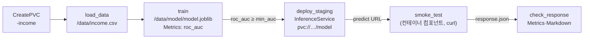

# [MLOps 스터디 4주차] 모델 훈련과 검증 — KFP 훈련 파이프라인을 KServe로 검증하고, MLflow로 추적

## TL;DR

- **8장**은 노트북에서 돌리던 훈련을 **파이프라인 컴포넌트**로 옮기는 이야기다. 데이터 받기 → 훈련 → 검증 단계로 나누고, 검증 결과를 KFP 지표(Metrics, Markdown)로 남긴다. 시스템 라이브러리가 필요한 단계는 **컨테이너 컴포넌트**로 만든다. 책은 신분증 탐지(YOLO)를 예제로 쓴다.
- **9장**은 같은 파이프라인을 다듬는다. 단계마다 데이터를 다시 받던 것을 **PVC 하나에 두고 공유**하고, 훈련 곡선은 **텐서보드**로 본다. 후반은 **영화 추천기**(파이토치 행렬 분해)로 넘어가 RMSE·Precision@50·Recall@50을 **MLflow**에 기록하고 레지스트리에 올린다.
- 실습은 YOLO 대신 2·3주차의 **소득 분류기**로 했다. 훈련한 모델을 파이프라인이 직접 **KServe 스테이징에 띄우고 시험 요청까지 보내서** 검증한다. 책 8.1.7의 "사람이 모델 파일을 열어 확인"을 자동 단계로 바꾼 셈이다. 클러스터는 맥북 kind + **Kubeflow Pipelines 2.18.0 단독 설치**.

---

## 8장. 모델 훈련과 검증 I

### 왜 컴포넌트로 나누나

책의 표현을 빌리면, 노트북 훈련은 "돌아가긴 하는데 다시 돌리기 어려운" 상태다. 파이프라인 컴포넌트로 바꾸면 이런 게 달라진다.

- 코드와 이미지가 버전으로 남아서 같은 훈련을 다시 돌릴 수 있다
- 어느 클러스터에서 돌려도 같은 환경이다
- 데이터 준비(7장)와 바로 이어 붙일 수 있다
- 단계별 입출력과 지표가 UI에 남아서 비교가 쉽다

책의 예제는 신분증 탐지 모델(YOLOv8n)이다. 데이터 받기 → 훈련 → 검증 3단계이고, 기본값은 `epochs=30`, `imgsz=640`. 하이퍼파라미터를 하나하나 튜닝하기보다 "웬만한 경우에 무난한 기본값"을 두라는 게 책의 입장이다.

### 컨테이너 컴포넌트가 필요한 이유

책에서 YOLO가 쓰는 OpenCV는 `libGL.so.1` 같은 시스템 라이브러리를 찾는다. 가벼운 파이썬 컴포넌트(`packages_to_install`)는 pip 패키지만 깔아 주기 때문에 이런 오류가 난다.

```text
ImportError: libGL.so.1: cannot open shared object file: No such file or directory
```

| 방법 | 내용 |
| --- | --- |
| 가벼운 컴포넌트 + 베이스 이미지 | `@dsl.component(base_image=...)`에 필요한 게 다 든 이미지를 준다. 함수는 그대로 파이썬으로 쓴다 |
| 컨테이너 컴포넌트 | `@dsl.container_component` + `dsl.ContainerSpec(image, command, args)`. 파이썬이 아닌 도구(curl, kubectl, 셸 스크립트)를 그대로 돌릴 때 |

정리하면, 결과를 KFP 지표로 남겨야 하는 단계는 가벼운 컴포넌트가 편하고, 명령 한 줄로 끝나는 단계는 컨테이너 컴포넌트가 깔끔하다. 이번 실습에서는 KServe에 시험 요청을 보내는 단계를 `curl` 이미지로 만들어 컨테이너 컴포넌트를 써 봤다.

### 검증 컴포넌트와 KFP 지표

검증은 정확도 하나 보는 게 아니라 "배포해도 되는지 판단할 근거"를 남기는 일이다. KFP v2는 출력 타입으로 이걸 받는다.

| 출력 타입 | 쓰는 곳 |
| --- | --- |
| `Output[Metrics]` | 숫자 지표. 실행 비교 화면에서 나란히 볼 수 있다 (`log_metric`) |
| `Output[Markdown]` | 표처럼 사람이 읽을 요약 |
| `Output[ClassificationMetrics]` | 혼동 행렬·ROC 곡선 |

### 아티팩트 검증 — "신뢰하되, 검증하라"

파이프라인이 초록불이어도 모델 파일을 직접 돌려 봐야 한다는 게 8.1.7의 요지다. 책은 사전 훈련 모델과 훈련한 모델로 같은 샘플 이미지를 돌려 비교한다.

이번 실습은 이걸 한 걸음 더 나가서 **파이프라인 안에서** 했다. 지표가 기준을 넘으면 그 모델을 KServe 스테이징에 실제로 띄우고, 결과를 알고 있는 입력 몇 개를 보내 응답이 상식과 맞는지 본다. 이렇게 하면 "모델 파일은 멀쩡한데 서빙 런타임에서 안 읽힌다" 같은 문제도 배포 전에 걸린다.

> 💡 **느낀 점**: 저자가 "운영하라고 넘겨받은 모델이 한참 뒤에 보니 제대로 동작하지 않았던 적이 많았다"고 쓴 대목이 인상적이었다. 파이프라인이 성공했다는 것과 모델이 서빙에서 쓸 만하다는 건 다른 얘기다. 훈련 지표, 서빙 시험, 사람이 보는 샘플 확인을 단계로 나눠 두는 게 맞다.

---

## 9장. 모델 훈련과 검증 II

### 9.1 PVC로 데이터 공유

8장 파이프라인은 단계마다 아티팩트로 데이터를 주고받는다. 데이터셋이 크면 매 단계 업로드·다운로드가 반복돼서 느리다. 9장은 **PVC 하나를 만들어 모든 단계가 같은 폴더를 보게** 바꾼다.

**책과 다른 점**: 책 코드의 `dsl.VolumeOp`, `.add_pvolumes()`는 **KFP v1 문법**이라 v2 SDK에는 없다. v2에서는 별도 패키지 `kfp-kubernetes`를 쓴다.

| 책 (KFP v1) | KFP v2 + kfp-kubernetes |
| --- | --- |
| `dsl.VolumeOp(name=..., size="5Gi", modes=dsl.VOLUME_MODE_RWO)` | `kubernetes.CreatePVC(pvc_name_suffix="-data", access_modes=["ReadWriteOnce"], size="5Gi", storage_class_name="standard")` |
| `task.add_pvolumes({"/data": vop.volume})` | `kubernetes.mount_pvc(task, pvc_name=pvc.outputs["name"], mount_path="/data")` |
| (없음) | `kubernetes.DeletePVC(pvc_name=pvc.outputs["name"])` — 정리 단계 |

데이터셋 분할(9.1.5)도 파이프라인 안에서 직접 한다. 비율과 시드를 파이프라인 파라미터로 빼 두면 같은 분할을 다시 만들 수 있다.

이번 실습에서는 PVC가 한 가지 일을 더 한다. KServe가 `storageUri: pvc://<PVC 이름>/model`로 **같은 PVC에서 모델을 바로 읽는다.** 훈련 결과를 따로 옮기지 않아도 된다.

### 9.2 텐서보드

책은 YOLO 훈련 곡선을 Kubeflow 중앙 대시보드의 Tensorboards 메뉴로 본다. 볼 것은 세 가지면 충분하다.

- 훈련 손실이 계속 내려가는지
- 검증 지표가 어느 에폭에서 평평해지는지 (거기가 에폭 수를 줄여도 되는 지점)
- 훈련 손실은 내려가는데 검증 손실이 올라가면 과적합

이번 실습은 KFP만 설치해서 그 메뉴가 없다. 추천기 훈련에서 `torch.utils.tensorboard`로 이벤트 파일을 남기고, MLflow 아티팩트로 올린 뒤 맥에서 텐서보드로 열었다(Step 5).

### 9.3 영화 추천기 + MLflow

| 단계 | 내용 |
| --- | --- |
| 데이터 읽기·품질 확인 | 평점 범위(0.5~5.0), 빈 값, 중복 (사용자, 영화) 쌍 확인. 문제가 있으면 여기서 실패시킨다 |
| 훈련 | 파이토치 **행렬 분해**: 사용자·영화 임베딩(기본 20차원) → 은닉층 → 평점 예측 |
| 평가 | **RMSE**(평점 오차, 낮을수록 좋음), **Precision@50·Recall@50**(상위 50개 추천 기준, 높을수록 좋음) |
| 추적 | 파라미터·지표·모델을 MLflow 런으로 기록 |
| 레지스트리 | 기준을 넘으면 등록, 별칭으로 꺼내 씀 |
| 로컬 추론 | 노트북에서 레지스트리 모델을 불러 한 사용자에게 추천 |

책이 강조하는 건 **지표를 먼저 정하라**는 것이다. 모델을 만들고 나서 좋아 보이는 숫자를 고르면 안 되고, 비즈니스 목표에서 지표를 정한 뒤 모델을 만든다. 추천에서 RMSE만 보면 "평점은 잘 맞히는데 정작 볼 만한 영화는 못 추천하는" 모델이 나올 수 있어서 Precision·Recall을 같이 본다.

> 💡 **느낀 점**: 2주차에 MLflow를 혼자 쓸 때는 "기록 도구"로만 봤는데, 파이프라인 안에 들어가니 성격이 달라진다. 파이프라인이 매번 런을 남기고 기준을 넘는 모델만 레지스트리에 올리면, 사람이 하던 "이번 모델 괜찮나?" 판단의 일부가 자동화된다.

---

## 실습: kind + KFP 2.18.0 + KServe

명령별 출력은 정상 동작 기준 예시다.

### 환경

| 항목 | 내용 |
| --- | --- |
| 하드웨어 | MacBook Pro, Apple M4 Pro, 메모리 24GB |
| 컨테이너 | OrbStack (VM 메모리 16GB) |
| 클러스터 | kind v0.33.0, `week04` (control-plane 1 + worker 1) |
| 파이프라인 | Kubeflow Pipelines **2.18.0** 단독 설치 (platform-agnostic), SDK `kfp`·`kfp-kubernetes` 2.18.0 |
| 서빙 | cert-manager v1.21.3 + **KServe v0.21.0** Standard 모드 (3주차와 같은 설치) |
| 훈련 | scikit-learn **1.5.2** (KServe sklearn 런타임과 맞춤), torch 2.15.0 |
| 추적 | MLflow 3.18.0 (클러스터 안, SQLite + PVC) |
| 데이터 | 소득 분류: UCI Adult / 추천: MovieLens `ml-latest-small` |

**책과 다른 점**

| 책 | 이번 실습 | 이유 |
| --- | --- | --- |
| 신분증 탐지 YOLO 훈련 | **소득 분류기(sklearn)** 훈련 | 2·3주차 모델을 이어 쓰고, CPU에서 몇 초면 끝나 파이프라인 흐름에 집중할 수 있다 |
| 8.1.7 사람이 모델 파일을 열어 확인 | 파이프라인이 **KServe 스테이징에 배포 → 시험 요청 → 응답 확인** | 서빙 런타임에서 실제로 읽히는지까지 배포 전에 확인 |
| Kubeflow 전체 설치 | KFP 단독 설치 | 노트북·텐서보드 메뉴는 없지만 맥에서 가볍게 돌릴 수 있다 |
| 아티팩트 저장소 MinIO | **SeaweedFS** | KFP 2.18.0 매니페스트의 기본 저장소가 SeaweedFS다 (`third-party/seaweedfs`) |
| `dsl.VolumeOp` (v1) | `kfp-kubernetes`의 `CreatePVC`·`mount_pvc` | v2 SDK에는 VolumeOp가 없다 |

### Step 1. 클러스터와 KFP 설치

```yaml
# kind-week04.yaml
kind: Cluster
apiVersion: kind.x-k8s.io/v1alpha4
name: week04
nodes:
  - role: control-plane
  - role: worker
```

```bash
kind create cluster --config kind-week04.yaml

export PIPELINE_VERSION=2.18.0
kubectl apply -k "github.com/kubeflow/pipelines/manifests/kustomize/cluster-scoped-resources?ref=$PIPELINE_VERSION"
kubectl wait --for condition=established --timeout=60s crd/applications.app.k8s.io
kubectl apply -k "github.com/kubeflow/pipelines/manifests/kustomize/env/platform-agnostic?ref=$PIPELINE_VERSION"
kubectl -n kubeflow wait --for=condition=Available deploy --all --timeout=900s
```

```text
$ kubectl get pods -n kubeflow
NAME                                               READY   STATUS    RESTARTS      AGE
cache-deployer-deployment-6f9b8d8c6b-p2lzs         1/1     Running   0             6m12s
cache-server-7c5d9f6b9d-q8w7n                      1/1     Running   0             6m12s
metadata-envoy-deployment-5b8c7d6f9c-tx4kd         1/1     Running   0             6m12s
metadata-grpc-deployment-6d8b8f5c7b-2mhz9          1/1     Running   2 (5m ago)    6m12s
metadata-writer-7f6c8d9b5d-h9qrx                   1/1     Running   0             6m12s
ml-pipeline-6b8d7f9c5d-wq7mz                       1/1     Running   1 (4m ago)    6m12s
ml-pipeline-persistenceagent-5c9d7b8f6d-zr4pn      1/1     Running   0             6m12s
ml-pipeline-scheduledworkflow-7d6c9b8f5c-k2v8x     1/1     Running   0             6m12s
ml-pipeline-ui-6c7b9d8f5c-8xq2t                    1/1     Running   0             6m12s
ml-pipeline-viewer-crd-5d8c7b9f6c-n4dpl            1/1     Running   0             6m12s
ml-pipeline-visualizationserver-7b9c8d6f5d-tq9wr   1/1     Running   0             6m12s
mysql-6c8d9b7f5c-x2kw8                             1/1     Running   0             6m12s
seaweedfs-5d7c8b9f6d-r8tnz                         1/1     Running   0             6m12s
workflow-controller-7c9b8d6f5c-mz4vq               1/1     Running   0             6m12s
```

- `metadata-grpc`와 `ml-pipeline`의 재시작 1~2번은 MySQL이 먼저 뜨기를 기다리다 생기는 것이라 신경 쓰지 않아도 된다. 계속 늘어나면 `kubectl logs`로 DB 연결을 본다.
- 첫 설치는 이미지 받는 데 시간이 대부분 걸린다. 넉넉히 10분은 잡는다.

```bash
kubectl port-forward -n kubeflow svc/ml-pipeline-ui 8080:80      # UI: http://localhost:8080
pip install kfp==2.18.0 kfp-kubernetes==2.18.0
```

### Step 2. KServe와 파이프라인 권한

KServe는 3주차 Step 2~3과 같다(cert-manager → KServe CRD → KServe Standard 모드).

```bash
helm install cert-manager oci://quay.io/jetstack/charts/cert-manager --version v1.21.3 \
  -n cert-manager --create-namespace --set crds.enabled=true
kubectl apply -f https://github.com/kubernetes-sigs/gateway-api/releases/download/v1.2.1/standard-install.yaml
helm install kserve-crd oci://ghcr.io/kserve/charts/kserve-crd --version v0.21.0 -n kserve --create-namespace
helm install kserve oci://ghcr.io/kserve/charts/kserve-resources --version v0.21.0 -n kserve \
  --set kserve.controller.deploymentMode=Standard \
  --set kserve.controller.gateway.ingressGateway.enableGatewayApi=true \
  --set kserve.controller.gateway.ingressGateway.kserveGateway=kserve/kserve-ingress-gateway
```

파이프라인 단계 파드는 `kubeflow` 네임스페이스의 서비스 계정 `pipeline-runner`로 돈다. 이 계정은 InferenceService를 만들 권한이 없어서 따로 준다. 스테이징 모델도 같은 네임스페이스에 띄운다. `pvc://`는 **같은 네임스페이스의 PVC**만 읽을 수 있고, 파이프라인이 만드는 PVC가 `kubeflow`에 생기기 때문이다.

```yaml
# pipeline-kserve-rbac.yaml
apiVersion: rbac.authorization.k8s.io/v1
kind: Role
metadata: { name: pipeline-kserve, namespace: kubeflow }
rules:
  - apiGroups: ["serving.kserve.io"]
    resources: ["inferenceservices"]
    verbs: ["get", "list", "create", "patch", "delete"]
---
apiVersion: rbac.authorization.k8s.io/v1
kind: RoleBinding
metadata: { name: pipeline-kserve, namespace: kubeflow }
roleRef: { apiGroup: rbac.authorization.k8s.io, kind: Role, name: pipeline-kserve }
subjects:
  - { kind: ServiceAccount, name: pipeline-runner, namespace: kubeflow }
```

```bash
kubectl apply -f pipeline-kserve-rbac.yaml
kubectl auth can-i create inferenceservices.serving.kserve.io -n kubeflow \
  --as system:serviceaccount:kubeflow:pipeline-runner
```

```text
yes
```

### Step 3. MLflow (9.3용)

2주차 MLflow를 클러스터 안으로 옮긴 형태다. 단일 사용자, SQLite + PVC, 아티팩트는 `--serve-artifacts`로 서버가 받는다.

```yaml
# mlflow.yaml (요약)
apiVersion: apps/v1
kind: Deployment
metadata: { name: mlflow, namespace: mlflow }
spec:
  replicas: 1
  strategy: { type: Recreate }
  selector: { matchLabels: { app: mlflow } }
  template:
    metadata: { labels: { app: mlflow } }
    spec:
      containers:
        - name: mlflow
          image: ghcr.io/mlflow/mlflow:v3.18.0
          command: ["mlflow", "server", "--host", "0.0.0.0", "--port", "5000",
                    "--backend-store-uri", "sqlite:////data/mlflow.db",
                    "--artifacts-destination", "/data/artifacts", "--serve-artifacts",
                    "--allowed-hosts", "mlflow.mlflow.svc.cluster.local:5000,localhost:5050"]
          volumeMounts: [{ name: data, mountPath: /data }]
      volumes:
        - name: data
          persistentVolumeClaim: { claimName: mlflow-data }
```

```bash
kubectl create ns mlflow
kubectl apply -f mlflow.yaml          # PVC mlflow-data 5Gi + Deployment + Service mlflow:5000
kubectl port-forward -n mlflow svc/mlflow 5050:5000
```

- 맥에서는 5050으로 연다. 5000은 AirPlay 수신이 쓰고 있다.
- MLflow 3.x는 Host 헤더를 검사한다. 클러스터 안 이름(`mlflow.mlflow.svc.cluster.local:5000`)을 `--allowed-hosts`에 넣지 않으면 파이프라인 단계에서 403이 난다.

### Step 4. 훈련 → 검증 → KServe 스테이징 시험 (8장 + 9.1)



```python
# income_pipeline.py
from kfp import dsl, compiler, kubernetes
from kfp.dsl import Artifact, Input, Output, Metrics, Markdown

COLS = ["Workclass", "Education", "Marital-Status", "Occupation", "Relationship", "Race", "Sex", "Native_country"]
SK = ["scikit-learn==1.5.2", "pandas", "joblib"]              # KServe v0.21 sklearn 런타임이 1.5.2 — 맞춰야 읽힌다
PAYLOAD = ('{"instances": ['
           '["Private","Masters","Married-civ-spouse","Exec-managerial","Husband","White","Male","United-States"],'
           '["Private","HS-grad","Never-married","Handlers-cleaners","Own-child","White","Female","United-States"]]}')


@dsl.component(base_image="python:3.12-slim", packages_to_install=["pandas"])
def load_data(path: str):
    import os, pandas as pd
    names = ["Age", "Workclass", "fnlwgt", "Education", "Education_num", "Marital-Status", "Occupation",
             "Relationship", "Race", "Sex", "Capital_gain", "Capital_loss", "Hours_per_week", "Native_country", "Target"]
    url = "https://archive.ics.uci.edu/ml/machine-learning-databases/adult/adult.data"
    df = pd.read_csv(url, header=None, names=names, skipinitialspace=True, na_values="?")
    df = df[["Workclass", "Education", "Marital-Status", "Occupation", "Relationship", "Race", "Sex", "Native_country", "Target"]].dropna()
    os.makedirs(path, exist_ok=True)
    df.to_csv(f"{path}/income.csv", index=False)
    print(f"rows={len(df)} >50K={int((df.Target == '>50K').sum())}")


@dsl.component(base_image="python:3.12-slim", packages_to_install=SK)
def train(path: str, test_size: float, seed: int, metrics: Output[Metrics]) -> float:
    import os, joblib, pandas as pd
    from sklearn.compose import ColumnTransformer
    from sklearn.ensemble import HistGradientBoostingClassifier
    from sklearn.metrics import roc_auc_score
    from sklearn.model_selection import train_test_split
    from sklearn.pipeline import Pipeline
    from sklearn.preprocessing import OneHotEncoder
    df = pd.read_csv(f"{path}/income.csv")
    y = (df.pop("Target") == ">50K").astype(int)
    X = df.to_numpy(dtype=object)                              # 서버는 열 이름 없는 배열을 넘긴다 — 열 번호로 인코딩
    Xtr, Xte, ytr, yte = train_test_split(X, y, test_size=test_size, random_state=seed, stratify=y)
    pipe = Pipeline([("onehot", ColumnTransformer([("cat", OneHotEncoder(handle_unknown="ignore"), list(range(8)))])),
                     ("model", HistGradientBoostingClassifier(max_iter=200, random_state=seed))])
    pipe.fit(Xtr, ytr)
    auc = float(roc_auc_score(yte, pipe.predict_proba(Xte)[:, 1]))
    metrics.log_metric("roc_auc", round(auc, 4))
    metrics.log_metric("accuracy", round(float(pipe.score(Xte, yte)), 4))
    os.makedirs(f"{path}/model", exist_ok=True)
    joblib.dump(pipe, f"{path}/model/model.joblib")
    print(f"roc_auc={auc:.4f}")
    return auc


@dsl.component(base_image="python:3.12-slim", packages_to_install=["kubernetes"])
def deploy_staging(pvc_name: str, name: str, namespace: str) -> str:
    import time
    from kubernetes import client, config
    config.load_incluster_config()
    api = client.CustomObjectsApi()
    g, v, plural = "serving.kserve.io", "v1beta1", "inferenceservices"
    body = {"apiVersion": f"{g}/{v}", "kind": "InferenceService", "metadata": {"name": name, "namespace": namespace},
            "spec": {"predictor": {"minReplicas": 1, "maxReplicas": 1, "model": {
                "modelFormat": {"name": "sklearn"}, "protocolVersion": "v1",
                "storageUri": f"pvc://{pvc_name}/model",
                "env": [{"name": "PREDICT_PROBA", "value": "true"}]}}}}
    try:
        api.create_namespaced_custom_object(g, v, namespace, plural, body)
    except client.ApiException as e:
        if e.status != 409:
            raise
        api.patch_namespaced_custom_object(g, v, namespace, plural, name, body)   # 이미 있으면 새 모델로 바꿈
    for i in range(60):
        st = api.get_namespaced_custom_object(g, v, namespace, plural, name).get("status", {})
        if any(c["type"] == "Ready" and c["status"] == "True" for c in st.get("conditions", [])):
            print(f"{name} Ready ({i * 10}s)")
            return f"http://{name}-predictor.{namespace}.svc.cluster.local/v1/models/{name}:predict"
        time.sleep(10)
    raise RuntimeError(f"{name} 가 10분 안에 Ready 가 되지 않음")


@dsl.container_component
def smoke_test(url: str, response: Output[Artifact]):
    # 컨테이너 컴포넌트 — 파이썬 없이 curl 만. 200 이 아니면 단계 실패
    return dsl.ContainerSpec(
        image="curlimages/curl:8.17.0",
        command=["sh", "-c"],
        args=['mkdir -p "$(dirname "$1")"; '
              'code=$(curl -s -o "$1" -w "%{http_code}" -H "Content-Type: application/json" -d "$2" "$0"); '
              'echo "HTTP $code"; cat "$1"; echo; [ "$code" = 200 ]',
              url, response.path, PAYLOAD],
    )


@dsl.component(base_image="python:3.12-slim")
def check_response(response: Input[Artifact], metrics: Output[Metrics], report: Output[Markdown]):
    import json
    preds = json.load(open(response.path))["predictions"]
    assert len(preds) == 2 and all(abs(sum(p) - 1) < 1e-6 for p in preds), f"응답 형식이 이상함: {preds}"
    hi, lo = preds[0][1], preds[1][1]
    metrics.log_metric("p_over_50k_masters_exec", round(hi, 3))
    metrics.log_metric("p_over_50k_hsgrad_handlers", round(lo, 3))
    with open(report.path, "w") as f:
        f.write("| 입력 | P(>50K) |\n|---|---|\n"
                f"| 석사·관리직·기혼 | {hi:.3f} |\n| 고졸·단순노무·미혼 | {lo:.3f} |\n")
    assert hi > lo, "상식과 반대 — 모델이나 열 순서를 확인"


@dsl.pipeline(name="income-train-validate")
def income_pipeline(min_auc: float = 0.85, test_size: float = 0.2, seed: int = 42):
    pvc = kubernetes.CreatePVC(pvc_name_suffix="-income", access_modes=["ReadWriteOnce"],
                               size="1Gi", storage_class_name="standard")
    load = load_data(path="/data")
    tr = train(path="/data", test_size=test_size, seed=seed).after(load)
    for t in (load, tr):
        kubernetes.mount_pvc(t, pvc_name=pvc.outputs["name"], mount_path="/data")
    with dsl.If(tr.outputs["Output"] >= min_auc):
        dep = deploy_staging(pvc_name=pvc.outputs["name"], name="income-staging", namespace="kubeflow")
        st = smoke_test(url=dep.output)
        check_response(response=st.outputs["response"])


compiler.Compiler().compile(income_pipeline, "income_pipeline.yaml")
```

몇 군데 짚고 가면:

- `SK`, `PAYLOAD` 같은 모듈 상수를 **데코레이터 인자와 컨테이너 컴포넌트**에 쓰는 건 괜찮다. 컴파일할 때 값이 들어가기 때문이다. 반대로 가벼운 컴포넌트의 **함수 본문 안**에서 모듈 상수를 쓰면 안 보인다(Step 5 참고).
- `load_data`와 `train`은 PVC로만 이어져 있어서 `.after()`가 없으면 KFP가 순서를 모르고 동시에 띄운다.
- `train`의 반환값(float)은 `tr.outputs["Output"]`으로 꺼낸다. `dsl.If`는 파이썬 비교가 아니라 KFP 조건식으로 컴파일된다.
- PVC는 지우지 않는다. 스테이징 모델이 계속 그 PVC를 읽고 있다.

```bash
python income_pipeline.py
python -c "import kfp; c = kfp.Client(host='http://localhost:8080'); \
  print(c.create_run_from_pipeline_package('income_pipeline.yaml', experiment_name='income').run_id)"
```

```text
7b1e4c2a-9d3f-4a6b-8e2c-5f1a9b7d3e60
```

**단계별 로그**

```text
# load-data
rows=30162 >50K=7508

# train
roc_auc=0.8781

# deploy-staging
income-staging Ready (40s)

# smoke-test
HTTP 200
{"predictions":[[0.1352,0.8648],[0.9961,0.0039]]}
```

**지표 (Run 화면 → Visualizations)**

| 단계 | 지표 | 값 |
| --- | --- | --- |
| train | roc_auc | 0.8781 |
| train | accuracy | 0.8279 |
| check-response | p_over_50k_masters_exec | 0.865 |
| check-response | p_over_50k_hsgrad_handlers | 0.004 |

- AUC는 2주차 로컬 훈련(0.8778)과 거의 같다. scikit-learn 버전과 분할 방식(`stratify`)만 달라서 나는 차이다.
- 스테이징 응답의 확률이 2주차 `@champion` 모델로 같은 두 사람을 넣었을 때와 비슷하면 정상이다.

```text
$ kubectl get isvc,pods -n kubeflow -l serving.kserve.io/inferenceservice=income-staging
NAME                                                 URL                                           READY   AGE
inferenceservice.serving.kserve.io/income-staging   http://income-staging-kubeflow.example.com   True    3m

NAME                                            READY   STATUS    RESTARTS   AGE
pod/income-staging-predictor-7d9f8c6b5d-4xk2p   1/1     Running   0          3m
```

**기준을 못 넘으면**

`min_auc=0.95`로 다시 돌리면 `train`까지만 돌고 `deploy-staging`, `smoke-test`, `check-response`는 실행되지 않는다(Run 그래프에서 회색). 스테이징에는 이전 모델이 그대로 남는다.

**스테이징 모델 직접 확인 (8.1.7을 손으로)**

파이프라인 시험과 별개로, 맥에서도 한 번 불러 본다.

```bash
kubectl port-forward -n kubeflow svc/income-staging-predictor 8081:80
curl -s localhost:8081/v1/models/income-staging:predict -H 'Content-Type: application/json' \
  -d '{"instances":[["Self-emp-inc","Doctorate","Married-civ-spouse","Prof-specialty","Husband","Asian-Pac-Islander","Male","Japan"]]}'
```

```text
{"predictions":[[0.2117,0.7883]]}
```

### Step 5. 영화 추천기 + MLflow + 텐서보드 (9.2~9.3)

```python
# movie_pipeline.py (핵심 부분)
from kfp import dsl
from kfp.dsl import Dataset, Input, Output, Model, Metrics

@dsl.component(base_image="python:3.12-slim", packages_to_install=["pandas", "pyarrow", "requests"])
def load_and_check(ratings: Output[Dataset]):
    import io, zipfile, requests, pandas as pd
    z = zipfile.ZipFile(io.BytesIO(requests.get(
        "https://files.grouplens.org/datasets/movielens/ml-latest-small.zip", timeout=120).content))
    df = pd.read_csv(z.open("ml-latest-small/ratings.csv"))
    assert df["rating"].between(0.5, 5.0).all(), "평점 범위 밖 값"
    assert not df[["userId", "movieId", "rating"]].isna().any().any(), "빈 값"
    assert not df.duplicated(["userId", "movieId"]).any(), "중복 평점"
    print(f"ratings={len(df)} users={df.userId.nunique()} movies={df.movieId.nunique()}")
    df.to_parquet(ratings.path)

@dsl.component(base_image="python:3.12-slim",
               packages_to_install=["torch==2.15.0", "tensorboard==2.21.0", "pandas", "pyarrow", "mlflow==3.18.0"])
def train_and_log(ratings: Input[Dataset], embedding: int, lr: float, epochs: int, tracking_uri: str,
                  metrics: Output[Metrics]) -> str:
    import mlflow, torch, pandas as pd
    from torch.utils.tensorboard import SummaryWriter
    mlflow.set_tracking_uri(tracking_uri)                    # 함수 안에서 쓰는 값은 파라미터로 받는다
    mlflow.set_experiment("movie-recommender")
    tb = SummaryWriter("/tmp/tb")
    # ... 행렬 분해 모델 정의·훈련(책 리스팅 9.11) — 에폭마다 tb.add_scalar("loss/train", …), ("rmse/val", …)
    # ... RMSE·Precision@50·Recall@50 계산(리스팅 9.12)
    with mlflow.start_run() as run:
        mlflow.log_params({"embedding": embedding, "lr": lr, "epochs": epochs})
        mlflow.log_metrics({"rmse": rmse, "precision_at_50": p50, "recall_at_50": r50})
        mlflow.pytorch.log_model(net, name="model")
        tb.close(); mlflow.log_artifacts("/tmp/tb", artifact_path="tensorboard")
    for k, v in {"rmse": rmse, "precision@50": p50, "recall@50": r50}.items():
        metrics.log_metric(k, round(v, 4))
    return run.info.run_id

@dsl.component(base_image="python:3.12-slim", packages_to_install=["mlflow==3.18.0"])
def register_if_better(run_id: str, max_rmse: float, tracking_uri: str):
    import mlflow
    from mlflow import MlflowClient
    mlflow.set_tracking_uri(tracking_uri)
    c = MlflowClient()
    rmse = c.get_run(run_id).data.metrics["rmse"]
    if rmse > max_rmse:
        print(f"rmse={rmse:.4f} > {max_rmse} — 등록 안 함"); return
    mv = mlflow.register_model(f"runs:/{run_id}/model", "movie-recommender")
    c.set_registered_model_alias("movie-recommender", "champion", mv.version)
    print(f"registered movie-recommender v{mv.version} @champion (rmse={rmse:.4f})")
```

`tracking_uri`는 파이프라인 파라미터로 `http://mlflow.mlflow.svc.cluster.local:5000`을 넘긴다. 처음에 모듈 상수로 두고 함수 안에서 쓰기 쉬운데, 가벼운 컴포넌트는 **함수 본문만 떼어 실행**하기 때문에 `NameError`가 난다.

```text
# load_and_check
ratings=100836 users=610 movies=9724

# train_and_log (마지막 에폭)
epoch 20/20 train_loss=0.6412 val_rmse=0.8931
precision@50=0.0614 recall@50=0.2287

# register_if_better (max_rmse=0.95)
registered movie-recommender v1 @champion (rmse=0.8931)
```

같은 파이프라인을 `embedding` 값만 바꿔 세 번 돌리면 MLflow에서 이렇게 비교된다.

| run | embedding | rmse | precision@50 | recall@50 |
| --- | --- | --- | --- | --- |
| 1 | 20 | 0.8931 | 0.0614 | 0.2287 |
| 2 | 50 | 0.8874 | 0.0652 | 0.2401 |
| 3 | 100 | 0.8952 | 0.0631 | 0.2319 |

- 임베딩을 키운다고 계속 좋아지지 않는다. 데이터가 10만 건이라 100차원은 과적합 쪽으로 간다.
- Precision@50이 0.06이면 낮아 보이지만, 사용자 한 명이 평가한 영화가 수십 편인 데 비해 후보는 9천여 편이라 이 정도가 보통이다. "인기 영화 50편을 모두에게 추천"하는 기준선과 비교해야 의미가 있다.
- 2번 런도 기준(0.95)을 넘으므로 v2로 올라가고 `@champion`이 옮겨 간다. 실제로는 "지금 champion보다 나을 때만" 옮기도록 비교 조건을 하나 더 두는 게 맞다.

**텐서보드 (9.2)**

```bash
mlflow artifacts download --run-id <2번 런 id> --artifact-path tensorboard -d ./tb   # MLFLOW_TRACKING_URI=http://localhost:5050
tensorboard --logdir ./tb
```

`rmse/val`이 15에폭 근처에서 평평해지고, 100차원 런(3번)은 그 뒤로 조금씩 다시 올라간다. 위 표에서 3번 RMSE가 더 나빴던 이유가 곡선으로 보인다.

**노트북에서 로컬 추론 (9.3.7)**

```python
import mlflow
mlflow.set_tracking_uri("http://localhost:5050")
net = mlflow.pytorch.load_model("models:/movie-recommender@champion")
# 사용자 1이 안 본 영화 중 예측 평점 상위 5편
```

```text
Shawshank Redemption, The (1994)          4.71
Godfather, The (1972)                     4.66
Fight Club (1999)                         4.58
Usual Suspects, The (1995)                4.55
Star Wars: Episode V (1980)               4.52
```

추천 목록이 "다들 좋아하는 명작" 위주면 인기도 편향이 강하다는 신호다. 다양성 지표(추천 목록의 장르 수, 인기 순위 분포)를 같이 보는 게 다음 단계다.

### 주의할 점

| 상황 | 원인 | 대처 |
| --- | --- | --- |
| 스테이징 predictor가 모델을 못 읽음 (`InconsistentVersionWarning`, 언피클 오류) | 훈련 scikit-learn과 KServe 런타임 버전 차이. v0.21.0 sklearn 런타임은 **1.5.2** | 훈련 단계 `scikit-learn==1.5.2` 고정. 버전을 올리면 런타임 버전부터 확인 |
| `deploy-staging`이 `403 Forbidden` | `pipeline-runner`에 InferenceService 권한 없음 | Step 2의 Role·RoleBinding |
| InferenceService가 `pvc://` 를 못 찾음 | PVC와 InferenceService의 네임스페이스가 다름 | 같은 네임스페이스(`kubeflow`)에 띄운다 |
| predictor가 `Pending` | RWO 볼륨이 다른 노드에 붙어 있음 | 워커 1개, 또는 노드 고정 |
| 단계들이 동시에 떠서 실패 | PVC로만 이어진 단계에 순서가 없음 | `.after()` |
| 컴포넌트 안에서 `NameError` | 모듈 상수를 가벼운 컴포넌트 본문에서 씀 | 파라미터로 넘기거나 함수 안에 적기 |
| 파이프라인 단계에서 MLflow 403 | Host 헤더 검사 | `--allowed-hosts`에 클러스터 안 주소 |
| `VolumeOp` 없음 | v1 문법 | `kfp-kubernetes` |
| (책 예제) `ImportError: libGL.so.1` | 가벼운 컴포넌트에 OpenCV 시스템 의존성이 없음 | 베이스 이미지를 주거나 컨테이너 컴포넌트, 또는 `opencv-python-headless` |

### 정리

```bash
kubectl delete isvc income-staging -n kubeflow
kubectl get pvc -n kubeflow                          # 파이프라인이 만든 PVC(이름 끝 -income)를 확인하고
kubectl delete pvc -n kubeflow <이름>-income
kind delete cluster --name week04
```

---

## 다음 주

- 10장 모델 추론과 서빙. 스테이징까지 왔으니 이번에는 운영용 InferenceService로 승격하는 흐름(카나리, 롤백)을 본다. `movie-recommender@champion`도 KServe로 올려 본다.
- 이번 주 파이프라인에 3주차 드리프트 확인 단계를 붙여, 데이터가 바뀌었으면 재훈련 → 스테이징 시험까지 이어지게.
